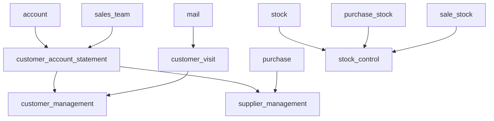

# custom_addons

Módulos propios para **Odoo 20.0 Community** que suman lo que el estándar no trae para la gestión comercial: estado de cuenta de clientes y proveedores, apps dedicadas a Clientes y Proveedores, registro de visitas a clientes y control de inventario.

## Módulos

| Módulo | Nombre | Qué resuelve | Depende de |
|---|---|---|---|
| [customer_account_statement](customer_account_statement/README.md) | Estado de cuenta de clientes y proveedores | Consultar, imprimir, enviar por email e imputar la cuenta corriente de clientes y proveedores, por empresa o consolidada por moneda. | `account`, `sales_team` |
| [customer_visit](customer_visit/) | Visitas a clientes | Planificar y registrar visitas a clientes, con resultado, próxima visita, chatter y actividades. | `mail` |
| [customer_management](customer_management/README.md) | Clientes (app) | Listado de clientes con asignación de vendedores, estado de cuenta, comprobantes, pagos recibidos, vencidos y visitas. Los vendedores pueden ver solo sus clientes. | `customer_account_statement`, `customer_visit` |
| [supplier_management](supplier_management/README.md) | Proveedores (app) | Listado de proveedores, estado de cuenta de proveedores, comprobantes, pagos realizados, vencidos y órdenes de compra. | `customer_account_statement`, `purchase` |
| [stock_control](stock_control/README.md) | Control de inventario (app) | Entradas y salidas de stock con motivo, controles de inventario con planilla de conteo y cierre (solo un administrador los reabre), y auditoría de movimientos, ficha por producto y diferencias. | `stock`, `purchase_stock`, `sale_stock` |

Cada módulo tiene su propio `README.md` con el detalle de funciones, configuración, permisos y cambios en la base de datos.

Orden de dependencias:



## Estructura del repositorio

```text
custom_addons/
├── customer_account_statement/   # un módulo por carpeta
├── customer_management/
├── customer_visit/
├── stock_control/
├── supplier_management/
├── specs/                        # especificaciones funcionales (SPEC 01, 02, ...)
├── AGENTS.md                     # reglas para agentes y convenciones del repo
└── README.md
```

En [specs/](specs/) está la especificación de cada funcionalidad, con su estado (Borrador, Aprobado, Implementado), el porqué y las decisiones tomadas.

## Requisitos

- Odoo **20.0** (rama `20.0`), clonado en una carpeta hermana de este repo:

  ```text
  Archivos/
  ├── odoo/            # código de Odoo 20.0
  └── custom_addons/   # este repo
  ```

- PostgreSQL con un usuario para Odoo.
- El entorno de Python de Odoo (`..\odoo\.venv`) con los requisitos de Odoo instalados.
- Los módulos actuales no usan librerías de Python extra. Si un módulo las necesita, trae un `requirements.txt` en su carpeta (ver [Librerías de Python](#librerías-de-python)).

## Instalación de los módulos

### 1. Clonar el repo

```powershell
cd C:\Users\<usuario>\Archivos
git clone https://github.com/Danito90/custom_addons.git
```

### 2. Agregar `custom_addons` al addons path

Odoo solo ve los módulos que están en el addons path. Se puede pasar por línea de comandos:

```powershell
cd ..\odoo
python odoo-bin -r odoo_user -w <password> --addons-path=addons,..\custom_addons -d <base>
```

o dejarlo fijo en el archivo de configuración (`odoo.conf`, que no se versiona):

```ini
[options]
addons_path = addons,..\custom_addons
db_user = odoo_user
db_password = <password>
```

```powershell
python odoo-bin -c odoo.conf -d <base>
```

Si falta `..\custom_addons` en el addons path, el log muestra `module <nombre>: not installable, skipped` y el módulo no se carga.

### 3. Instalar

Desde la línea de comandos, con `-i` y el nombre técnico. Odoo instala las dependencias solo, así que alcanza con nombrar el módulo final:

```powershell
# Un módulo
python odoo-bin -r odoo_user -w <password> --addons-path=addons,..\custom_addons -d <base> -i customer_management --stop-after-init

# Todos
python odoo-bin -r odoo_user -w <password> --addons-path=addons,..\custom_addons -d <base> -i customer_account_statement,customer_visit,customer_management,supplier_management,stock_control --stop-after-init
```

O desde la interfaz:

1. Arrancá Odoo con `custom_addons` en el addons path.
2. Activá el modo desarrollador (**Ajustes > Activar el modo de desarrollador**).
3. Andá a **Aplicaciones > Actualizar lista de aplicaciones**.
4. Buscá el módulo por nombre (por ejemplo, "Clientes") y tocá **Activar**.

### 4. Actualizar después de un cambio

Cada vez que cambia el código de un módulo (XML, CSV, campos o modelos), hay que actualizarlo en la base con `-u`:

```powershell
python odoo-bin -r odoo_user -w <password> --addons-path=addons,..\custom_addons -d <base> -u customer_account_statement --stop-after-init
```

Revisá que el log no tenga `ERROR` ni `WARNING` nuevos. Los cambios solo en Python necesitan reiniciar Odoo; los de vistas, datos y permisos necesitan `-u`.

### Librerías de Python

Si un módulo usa una librería que no viene con Odoo, la declara en `external_dependencies` del `__manifest__.py` y la lista en `<modulo>/requirements.txt`. Instalala en el entorno de Odoo antes de instalar el módulo:

```powershell
..\odoo\.venv\Scripts\python.exe -m pip install -r <modulo>\requirements.txt
```

Si falta, Odoo no deja instalar el módulo y avisa qué librería no encuentra.

## Desarrollo

- Las reglas para trabajar en el repo (README obligatorio por módulo, documentación de cambios en la base, convenciones de código y textos en español rioplatense) están en [AGENTS.md](AGENTS.md).
- Cada funcionalidad nueva arranca con una spec en [specs/](specs/) y se implementa en una rama `spec-NN-<nombre>`.
- Licencia de los módulos: LGPL-3.
