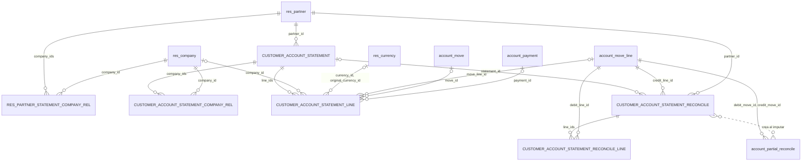

# Estado de cuenta de clientes

Módulo técnico: `customer_account_statement` · Odoo 20.0 · Dependencias: `account`, `sales_team` · Licencia LGPL-3

Permite consultar, imprimir, enviar por email e imputar la cuenta corriente de un cliente, por empresa o consolidada entre varias empresas del grupo.

## Qué hace

- **Consulta de cuenta corriente** en dos modos:
  - **Movimientos:** saldo inicial (si hay fecha "Desde"), todos los movimientos del período y saldo acumulado línea por línea.
  - **Solo pendientes:** comprobantes con saldo pendiente a la fecha "Hasta", con días de atraso. Los vencidos se resaltan en rojo.
- **Por empresa o consolidado:** con una empresa se ve su saldo. Con varias, los movimientos se agrupan **por moneda de la empresa** y aparece la columna "Empresa".
- **Detalle de imputaciones:** desde cada línea se ve con qué comprobantes está conciliada, y se puede **desimputar**.
- **Imputación de créditos:** desde un recibo o una nota de crédito con saldo, se eligen las facturas o notas de débito pendientes a las que se aplica.
- **Resumen en PDF** (ambos modos) con los datos de la empresa y del cliente.
- **Envío por email** del PDF al cliente, con una plantilla editable.

## Qué agrega o modifica en Odoo

| Dónde | Cambio |
|---|---|
| Contacto (`res.partner`) | Campo nuevo **"Empresas en las que participa"** (`company_ids`) en la pestaña *Ventas y compras → Varios*. Botón **"Estado de cuenta"** arriba de la ficha. |
| Conciliaciones (`account.partial.reconcile`) | Campos calculados de contraparte y botón **"Desimputar"**, usados en la lista de imputaciones. No cambia el comportamiento estándar. |
| Menú | **Contabilidad / Facturación → Clientes → Estado de cuenta**. |
| Reporte | **"Resumen de cuenta"** (PDF QWeb). |
| Plantilla de email | **"Estado de cuenta: envío de resumen al cliente"**. |
| Permisos | Acceso de lectura para **vendedores** a asientos, apuntes, pagos y conciliaciones **de sus propios clientes** (ver [Permisos](#permisos)). |

Modelos nuevos, todos transitorios (no guardan datos de forma permanente):

- `customer.account.statement`: asistente de consulta.
- `customer.account.statement.line`: líneas calculadas del estado de cuenta.
- `customer.account.statement.reconcile` y `.reconcile.line`: asistente de imputación.

No crea asientos ni modifica importes. Las imputaciones usan la conciliación estándar de Odoo.

## Cómo funciona

### Qué movimientos entran

Se toman los apuntes contables (`account.move.line`) que cumplen todo esto:

- Cuenta de tipo **A cobrar** (`asset_receivable`).
- Asiento **publicado**.
- Partner igual al cliente o a cualquiera de sus contactos hijos (se usa siempre la empresa principal del contacto).
- Empresa dentro de las elegidas en el asistente.

Los importes están en la **moneda de la empresa**. Si el comprobante fue en otra moneda, la moneda y el importe originales se muestran en columnas informativas.

### Qué empresas se pueden elegir

- Si el cliente **no tiene** empresas cargadas en "Empresas en las que participa", se ofrecen todas las empresas habilitadas del usuario.
- Si **tiene** empresas cargadas, se ofrecen solo las que están cargadas en el cliente **y** habilitadas para el usuario.
- Por defecto se elige la empresa activa, si está permitida; si no, la primera permitida.

### Pendiente a una fecha

En el modo "Solo pendientes", el saldo se calcula **a la fecha "Hasta"**. Las imputaciones posteriores a esa fecha se ignoran, así que un comprobante cobrado después vuelve a aparecer como pendiente.

### Imputación

- Botón **"Imputar"** en líneas de crédito (recibos, notas de crédito) que todavía tienen saldo.
- Lista las facturas y notas de débito pendientes del mismo cliente, **misma empresa y misma cuenta**, ordenadas por vencimiento.
- Se marcan los comprobantes. Para cada uno se propone el menor importe entre su pendiente y lo que queda disponible del crédito.
- **Importe parcial editable** solo si el crédito y la factura están en la moneda de la empresa. En otra moneda se imputa por el total posible.
- Al terminar, el estado de cuenta se recalcula solo.

## Uso

1. **Desde el menú:** Contabilidad / Facturación → Clientes → **Estado de cuenta**.
   **Desde el cliente:** botón **"Estado de cuenta"** en la ficha.
2. Elegir cliente, empresas, modo y fechas.
3. Usar uno de estos botones:
   - **Consultar:** abre la lista de líneas, que tiene sus propios botones Imprimir y Enviar por email.
   - **Imprimir:** descarga el PDF.
   - **Enviar por email:** abre el redactor de correo con el PDF adjunto.

En la lista de líneas, cada movimiento tiene tres botones:

- **Abrir comprobante:** abre la factura, la nota o el pago.
- **Imputaciones:** muestra con qué comprobantes está conciliado. Desde ahí se puede **desimputar**.
- **Imputar:** solo en créditos con saldo.

## Configuraciones esenciales

### 1. Cargar las empresas del cliente

1. Abrir el cliente (Contactos o Facturación → Clientes).
2. Ir a la pestaña **Ventas y compras** → bloque **Varios** → **"Empresas en las que participa"**.
3. Tildar las casillas de las empresas en las que opera el cliente y guardar.

Si no se tilda ninguna, el cliente se puede consultar en todas las empresas del usuario.

El campo **no aparece** en estos casos:
- El usuario no tiene permisos de Facturación.
- El contacto es un hijo (una persona dentro de una empresa). En ese caso se carga en la empresa padre.

### 2. Dar permisos a los usuarios

Ajustes → Usuarios y compañías → Usuarios → elegir el usuario.

| Perfil | Grupo en Odoo | Qué puede hacer |
|---|---|---|
| Facturación / Contabilidad | *Facturación* o superior (`account.group_account_invoice`) | Todo: consultar cualquier cliente, imprimir, enviar, imputar y desimputar. Ve el menú. |
| Vendedor | *Ventas: Usuario: solo sus documentos* o superior (`sales_team.group_sale_salesman`) | Consultar e imprimir **solo clientes donde figura como vendedor** (campo "Vendedor" del cliente). Entra por el botón de la ficha del cliente; no ve el menú. No puede enviar ni imputar. |

Para que un vendedor vea el estado de cuenta de un cliente, en la ficha del cliente → **Ventas y compras → Vendedor** tiene que figurar ese usuario.

### 3. Empresas habilitadas del usuario

Solo se pueden consultar empresas que el usuario tiene en **Empresas permitidas** (en la ficha del usuario). Para un consolidado, el usuario tiene que tener habilitadas todas las empresas que quiere sumar.

### 4. Plantilla de email

Ajustes → Técnico → Email → Plantillas → **"Estado de cuenta: envío de resumen al cliente"** (requiere el modo desarrollador).

- El asunto y el remitente usan la empresa y el email del usuario que envía.
- El cliente tiene que tener **email** cargado.
- La plantilla se carga con `noupdate`: los cambios que se le hagan **no se pisan** al actualizar el módulo.

### 5. Servidor de correo saliente

Para que el envío funcione, tiene que haber un servidor de correo saliente configurado en Ajustes → Técnico → Servidores de correo saliente.

### 6. Motor de PDF (wkhtmltopdf)

El resumen en PDF y el adjunto del email necesitan **wkhtmltopdf 0.12.6 (with patched qt)** instalado en el servidor, con el módulo estándar `base_report_wkhtmltox` (se instala solo).

Odoo busca el ejecutable en el `PATH`. Si no lo encuentra, al imprimir muestra *"No encontramos el motor de PDF en este sistema. El reporte aparecerá en formato HTML."* y el envío por email falla.

En Windows:
1. Agregar `C:\Program Files\wkhtmltopdf\bin` al `PATH` del usuario o del sistema.
2. Cerrar **todas** las ventanas de VS Code y las terminales, y volver a arrancar Odoo.

Para verificarlo, el log de arranque tiene que mostrar `Will use the Wkhtmltopdf binary at ...`.

Como alternativa, se puede indicar la carpeta con `bin_path = C:\Program Files\wkhtmltopdf\bin` en el archivo de configuración de Odoo (`-c odoo.conf`). Es una opción que solo se lee del archivo, no de la línea de comandos.

## Permisos

Definidos en [security/ir.access.csv](security/ir.access.csv) con el modelo `ir.access` de Odoo 20. Todos llevan grupo, así que son **permisos que suman**: si un usuario tiene varios, se combinan con OR. El módulo no agrega restricciones (permisos sin grupo).

| ID externo | Modelo | Grupo | Operaciones | Filtro (`domain`) | Para qué |
|---|---|---|---|---|---|
| `access_customer_account_statement_invoice` | `customer.account.statement` | Facturación | CRUD | — | Usar el asistente de consulta |
| `access_customer_account_statement_salesman` | `customer.account.statement` | Vendedor | CRUD | — | Ídem, para vendedores |
| `access_customer_account_statement_line_invoice` | `customer.account.statement.line` | Facturación | CRUD | — | Ver y generar las líneas |
| `access_customer_account_statement_line_salesman` | `customer.account.statement.line` | Vendedor | CRUD | — | Ídem, para vendedores |
| `access_customer_account_statement_reconcile_invoice` | `customer.account.statement.reconcile` | Facturación | CRUD | — | Asistente de imputación |
| `access_customer_account_statement_reconcile_line_invoice` | `customer.account.statement.reconcile.line` | Facturación | CRUD | — | Comprobantes del asistente de imputación |
| `customer_account_statement_move_salesman` | `account.move` | Vendedor | Lectura | `commercial_partner_id.user_id = usuario` | Abrir facturas y notas de sus clientes |
| `customer_account_statement_move_line_salesman` | `account.move.line` | Vendedor | Lectura | `partner_id.commercial_partner_id.user_id = usuario` | Leer los apuntes de sus clientes |
| `customer_account_statement_payment_salesman` | `account.payment` | Vendedor | Lectura | `partner_id.commercial_partner_id.user_id = usuario` | Abrir los pagos de sus clientes |
| `customer_account_statement_partial_salesman` | `account.partial.reconcile` | Vendedor | Lectura | Débito **o** crédito de un cliente propio | Ver las imputaciones de sus clientes |

"Facturación" es `account.group_account_invoice`; "Vendedor" es `sales_team.group_sale_salesman` (*Ventas: Usuario: solo sus documentos*).

Los cuatro últimos amplían permisos sobre modelos **estándar**. Por eso los vendedores, además del estado de cuenta, pueden ver los asientos, apuntes y pagos de sus clientes en otras pantallas de Odoo. Es solo lectura: no pueden modificar nada.

Controles adicionales en el código (no dependen de `ir.access`):

| Acción | Control |
|---|---|
| Consultar, imprimir | `_check_partner_access`: Facturación, o vendedor del cliente |
| Enviar por email | Solo Facturación |
| Imputar, desimputar | Solo Facturación |
| Empresas | Solo las permitidas para el cliente **y** habilitadas para el usuario |

El cálculo de líneas lee los apuntes con `sudo()` **después** de validar el acceso al cliente y a las empresas. Así los vendedores no dependen de tener permisos contables completos.

## Base de datos

### Resumen

- **Tablas nuevas:** 6 (1 permanente, 5 temporales).
- **Tablas existentes modificadas:** ninguna. El módulo **no agrega columnas** a tablas estándar.
- **Datos estándar que escribe:** registros en `account_partial_reconcile` (y `account_full_reconcile`, asientos de diferencia de cambio o de caja si corresponde), creados por la conciliación estándar de Odoo al **imputar**. Al **desimputar** se borra el registro de `account_partial_reconcile`.

### Esquema relacional

Las tablas del módulo aparecen en mayúsculas y las estándar de Odoo en minúsculas. La línea punteada es una relación que no está en una tabla del módulo: el asistente de imputación crea conciliaciones estándar.



### Tablas nuevas

`ON DELETE` indica qué pasa con la fila si se borra el registro referenciado. Todas las tablas con `id` tienen además las columnas estándar `create_uid`, `write_uid` (→ `res_users`, SET NULL), `create_date` y `write_date`.

#### `res_partner_statement_company_rel` — permanente

Empresas en las que participa cada cliente (campo `res.partner.company_ids`). Es la **única tabla con datos de negocio** del módulo.

| Columna | Tipo | Nulo | Referencia | ON DELETE |
|---|---|---|---|---|
| `partner_id` | integer | no | `res_partner.id` | CASCADE |
| `company_id` | integer | no | `res_company.id` | CASCADE |

Clave primaria `(partner_id, company_id)`; índice `(company_id, partner_id)`.

#### `customer_account_statement` — temporal

Cada consulta del asistente (`customer.account.statement`).

| Columna | Tipo | Nulo | Referencia | ON DELETE |
|---|---|---|---|---|
| `id` | integer | no | — | — |
| `partner_id` | integer | no | `res_partner.id` | CASCADE |
| `mode` | varchar | no | `movements` / `pending` | — |
| `date_from` | date | sí | — | — |
| `date_to` | date | no | — | — |

`allowed_company_ids` e `is_consolidated` son calculados y no se guardan.

#### `customer_account_statement_company_rel` — temporal

Empresas elegidas en cada consulta (campo `company_ids` del asistente).

| Columna | Tipo | Nulo | Referencia | ON DELETE |
|---|---|---|---|---|
| `statement_id` | integer | no | `customer_account_statement.id` | CASCADE |
| `company_id` | integer | no | `res_company.id` | CASCADE |

Clave primaria `(statement_id, company_id)`; índice `(company_id, statement_id)`.

#### `customer_account_statement_line` — temporal

Líneas calculadas del estado de cuenta. Es una **copia** de los datos al momento de consultar: no se actualiza si después cambia un comprobante.

| Columna | Tipo | Nulo | Referencia | ON DELETE |
|---|---|---|---|---|
| `id` | integer | no | — | — |
| `statement_id` | integer | no | `customer_account_statement.id` | CASCADE |
| `sequence` | integer | sí | — | — |
| `line_type` | varchar | no | `initial` / `move` | — |
| `company_id` | integer | sí | `res_company.id` | SET NULL |
| `currency_id` | integer | sí | `res_currency.id` (moneda de la empresa) | SET NULL |
| `move_line_id` | integer | sí | `account_move_line.id` | SET NULL |
| `move_id` | integer | sí | `account_move.id` | SET NULL |
| `payment_id` | integer | sí | `account_payment.id` | SET NULL |
| `document_type` | varchar | sí | — | — |
| `name` | varchar | sí | — | — |
| `date`, `date_maturity` | date | sí | — | — |
| `debit`, `credit`, `balance`, `cumulative_balance` | numeric | sí | — | — |
| `original_currency_id` | integer | sí | `res_currency.id` | SET NULL |
| `amount_currency` | numeric | sí | — | — |
| `amount_residual` | numeric | sí | — | — |
| `days_overdue` | integer | sí | — | — |
| `is_reconciled` | boolean | sí | — | — |

#### `customer_account_statement_reconcile` — temporal

Asistente de imputación (`customer.account.statement.reconcile`).

| Columna | Tipo | Nulo | Referencia | ON DELETE |
|---|---|---|---|---|
| `id` | integer | no | — | — |
| `statement_id` | integer | sí | `customer_account_statement.id` | SET NULL |
| `credit_line_id` | integer | no | `account_move_line.id` (el crédito a imputar) | CASCADE |
| `partner_id` | integer | no | `res_partner.id` | CASCADE |
| `available_amount` | numeric | sí | — | — |

#### `customer_account_statement_reconcile_line` — temporal

Comprobantes ofrecidos para imputar.

| Columna | Tipo | Nulo | Referencia | ON DELETE |
|---|---|---|---|---|
| `id` | integer | no | — | — |
| `reconcile_id` | integer | no | `customer_account_statement_reconcile.id` | CASCADE |
| `debit_line_id` | integer | no | `account_move_line.id` (la factura o ND) | CASCADE |
| `selected` | boolean | sí | — | — |
| `amount_residual` | numeric | sí | — | — |
| `amount_to_apply` | numeric | sí | — | — |
| `allow_partial` | boolean | sí | — | — |

Las tablas temporales son de modelos `TransientModel`: Odoo borra solo las filas viejas.

### Tablas existentes

| Tabla | Cambio de estructura | Escritura de datos |
|---|---|---|
| `res_partner` | Ninguno. `company_ids` vive en la tabla de relación. | No |
| `account_partial_reconcile` | Ninguno. `statement_counterpart_line_id` y `statement_counterpart_move_id` son calculados, sin columna. | Sí: altas al imputar, bajas al desimputar |
| `account_move_line`, `account_move` | Ninguno | Solo lo que actualiza la conciliación estándar (`amount_residual`, `reconciled`, estado de pago) |

### Registros de configuración

Se guardan en las tablas estándar de metadatos de Odoo y se identifican en `ir_model_data` con `module = 'customer_account_statement'`.

| Tabla | Registros |
|---|---|
| `ir_access` | 10 (ver [Permisos](#permisos)) |
| `ir_ui_view` | 7: formulario del asistente, lista de líneas, asistente de imputación, lista de imputaciones, herencia de la ficha de contacto y 2 plantillas QWeb del reporte |
| `ir_act_window` | 1: `action_customer_account_statement` |
| `ir_act_report_xml` | 1: `action_report_customer_account_statement` |
| `ir_ui_menu` | 1: `menu_customer_account_statement` |
| `mail_template` | 1: `mail_template_customer_account_statement` (`noupdate`) |
| `ir_model` / `ir_model_fields` / `ir_model_fields_selection` | 6 / 78 / 4, generados por Odoo a partir de los modelos |

### Al desinstalar

Se borran las 6 tablas nuevas, incluidas **las empresas cargadas en los clientes**, y todos los registros de configuración. Las conciliaciones creadas al imputar **quedan**: son datos contables estándar.

## Instalación y actualización

El módulo vive en `custom_addons`, que tiene que estar en el addons path:

```powershell
# Instalar
python odoo-bin -r odoo_user -w <password> --addons-path=addons,..\custom_addons -d <base> -i customer_account_statement

# Actualizar después de cambiar XML, CSV o campos
python odoo-bin -r odoo_user -w <password> --addons-path=addons,..\custom_addons -d <base> -u customer_account_statement
```

Si se arranca Odoo sin `..\custom_addons`, el log muestra `module customer_account_statement: not installable, skipped` y el módulo no se carga.

## Limitaciones conocidas

- Solo cuentas **a cobrar**. No muestra la cuenta corriente de proveedores.
- El consolidado **no convierte monedas**: empresas con monedas distintas se muestran en bloques separados.
- La imputación es entre comprobantes de la **misma empresa y la misma cuenta**.
- En moneda extranjera la imputación es por el total posible, no por un importe parcial.
- Las líneas son temporales: Odoo borra solas las consultas viejas. Para guardar un estado de cuenta, imprimir el PDF o enviarlo.

## Historial de cambios

### 2026-10-20
- **Documentación:** se agrega el requisito del motor de PDF (wkhtmltopdf en el `PATH`) a las configuraciones esenciales.
  - Base de datos: sin cambios.
- **Cambio:** en la ficha del cliente, "Empresas en las que participa" pasa de etiquetas (`many2many_tags`) a casillas para tildar (`many2many_checkboxes`).
  - Base de datos: se actualiza `arch_db` de la vista `res_partner_view_form_inherit_account_statement` en `ir_ui_view`. Sin cambios de tablas ni de datos.
- **Corrección:** el asistente fallaba al abrirse con `EvalError: Name 'len' is not defined`. La vista usaba `len(company_ids)` en un `invisible`, y el evaluador del navegador no tiene `len`. Ahora usa el campo calculado `is_consolidated`.
  - Base de datos: se actualiza `arch_db` de la vista `customer_account_statement_view_form` en `ir_ui_view`. Sin cambios de tablas ni de datos.
- Se agrega este README, con el detalle de base de datos y permisos.
  - Base de datos: sin cambios.

### 1.0
- Versión inicial según [specs/01-estado-de-cuenta-clientes.md](../specs/01-estado-de-cuenta-clientes.md).
  - Base de datos: crea las 6 tablas de [Tablas nuevas](#tablas-nuevas), los 10 permisos de `ir_access` y los registros de configuración. No modifica tablas existentes.
