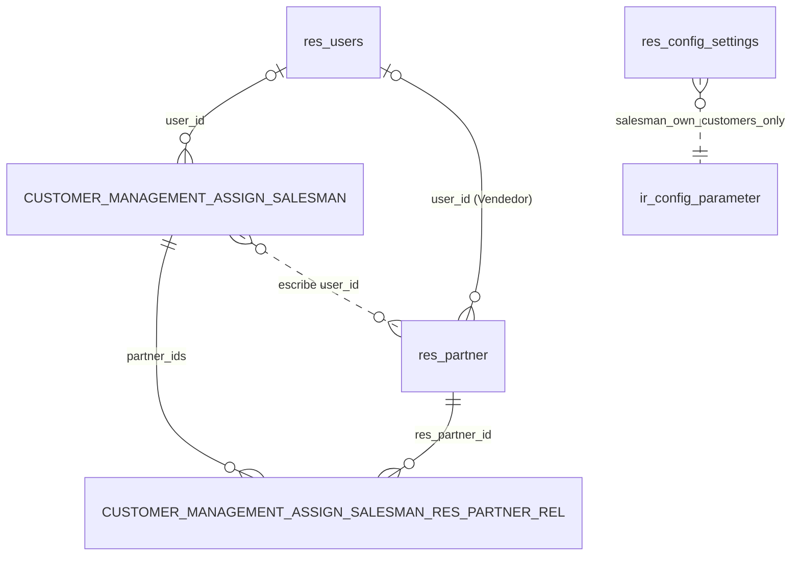

# Clientes

Módulo técnico: `customer_management` · Odoo 20.0 · Dependencias: `customer_account_statement`, `customer_visit`, `partner_vat_check` · Licencia LGPL-3

App "Clientes" que reúne en un solo lugar el listado de clientes, la asignación de vendedores, el estado de cuenta, los comprobantes y las visitas.

## Qué hace

- **App propia** en el menú principal, con ícono, para Facturación y vendedores.
- **Listado de Clientes** con filtros (Mis clientes, Sin vendedor, Con deuda, Con vencidos), búsqueda y agrupación por vendedor, empresa, ciudad y provincia.
- **Alta de clientes** con el botón **"Nuevo cliente"**, que abre la ficha completa con valores precargados.
- **Control de CUIT repetido** al guardar desde la app, configurable: Bloquear, Avisar o No controlar.
- **Asignación de vendedor**, de a varios clientes por vez o editando la columna en la lista.
- **Accesos directos** a estado de cuenta, facturas y notas, pagos recibidos, comprobantes vencidos y visitas.
- **Ajuste "Vendedores ven solo sus clientes"**: dentro de la app, cada vendedor ve solo sus clientes y lo relacionado con ellos.

## Qué agrega o modifica en Odoo

| Dónde | Cambio |
|---|---|
| Menú principal | App **Clientes** (`menu_customer_management_root`) con los menús de la [tabla de Uso](#uso). |
| Contactos (`res.partner`) | Campos calculados **Con deuda**, **Con vencidos** y **Puede asignar vendedor** (sin columna en la base). Vista lista y búsqueda propias de la app, que no reemplazan las de Contactos. Valores por defecto al crear desde la app (`default_get`). |
| Listado de Clientes | Botón **"Nuevo cliente"** en la cabecera, para *Creación de contactos* y Gerente de ventas. |
| Lista de contactos | Acción **"Asignar vendedor"** en el menú Acción. Aparece en **todas** las listas de contactos (Contactos, Facturación → Clientes, la app), solo para Facturación y Gerente de ventas. |
| Ajustes | Sección **Clientes** con el ajuste "Vendedores ven solo sus clientes" (`ir.config_parameter` `customer_management.salesman_own_customers_only`) y, en el bloque "Alta de clientes", **"CUIT repetido en Clientes"** (campo y parámetro de `partner_vat_check`). |
| Permisos | Acceso al asistente de asignación para Facturación y Gerente de ventas (ver [Permisos](#permisos)). |

Modelo nuevo (transitorio): `customer.management.assign.salesman`, el asistente "Asignar vendedor".

No modifica facturas, pagos ni visitas: los menús de la app abren las pantallas estándar con un filtro.

## Cómo funciona

### Qué es un cliente en el listado

- Contactos principales: empresas o contactos sin padre (`is_company = True` o `parent_id = False`).
- El filtro estándar **"Clientes"** (`customer_rank > 0`: alguna vez se le facturó) viene activo y se puede quitar, igual que en Facturación → Clientes.
- El filtro **"Mis clientes"** (Vendedor = usuario actual) viene activo y se puede quitar.

### Con deuda / Con vencidos

Usan la misma regla que el estado de cuenta, para que coincidan:

- Apuntes en cuentas **a cobrar**, de asientos **publicados**, del cliente y sus contactos hijos.
- Empresas: las "Empresas en las que participa" del cliente que el usuario tiene habilitadas. Si el cliente no tiene ninguna, todas las empresas del usuario.
- **Con deuda:** en alguna moneda de empresa, la suma de pendientes es mayor que cero.
- **Con vencidos:** tiene al menos un comprobante con pendiente positivo y vencimiento anterior a hoy. Los créditos (recibos o notas de crédito con saldo) no cuentan como vencidos.

### Alta de clientes

- El listado tiene `create="0"` porque es editable en línea: el "Nuevo" estándar agregaría una fila vacía. En su lugar, el botón **"Nuevo cliente"** de la cabecera abre la **ficha completa** del contacto.
- Lo ven *Creación de contactos* (`base.group_partner_manager`) y Gerente de ventas. Si el usuario no puede crear contactos (por ejemplo, Gerente de ventas sin el módulo `sale`), el botón da un error de acceso claro.
- La ficha nueva viene con:
  - **Es empresa** tildado y **cliente** (`customer_rank = 1`).
  - La **empresa activa** del usuario en "Empresas en las que participa".
  - **Vendedor** = quien crea, si tiene *Ventas: Usuario* (`sales_team.group_sale_salesman`), aunque además sea de Facturación o gerente. Si no, vacío. Se puede cambiar antes de guardar.
- Los mismos valores aplican al "Nuevo" de la vista kanban de la app. No aplican a los contactos hijos que se cargan dentro de la ficha.
- La precarga la hace `default_get` cuando el contexto trae `partner_vat_check_scope = 'customer'`. La acción del listado y el botón ponen esa clave.

### CUIT repetido

Lo hace el módulo `partner_vat_check`; acá se configura el ajuste **"CUIT repetido en Clientes"**:

- **Bloquear** (por defecto): al guardar un cliente con el CUIT de otro cliente activo, Odoo muestra un error con su nombre y no guarda.
- **Avisar:** guarda y deja una nota en el chatter del cliente.
- **No controlar.**

Rige solo al crear o editar desde la app Clientes, y compara solo contra clientes. El detalle de la regla está en el [README de partner_vat_check](../partner_vat_check/README.md).

### Asignación de vendedor

- **Vendedor** es el campo estándar `res.partner.user_id`, el mismo que usa el estado de cuenta para que el vendedor vea a sus clientes.
- **Acción masiva:** seleccionar clientes → Acción → **Asignar vendedor** → elegir vendedor → Asignar. Con el vendedor vacío, se les quita.
- **Columna editable:** en la lista de la app, hacer clic en la celda Vendedor de un cliente y elegirlo. También se pueden seleccionar varios y editar la celda de uno: Odoo pregunta si aplicarlo a todos.
- Ambas formas: solo Facturación y Gerente de ventas. Para los demás la columna es de solo lectura y la acción no aparece.

### Ajuste "Vendedores ven solo sus clientes"

- **Desactivado** (por defecto): los vendedores ven todos los clientes en la app.
- **Activado:** en los menús Clientes, Facturas y notas, Pagos recibidos, Comprobantes vencidos y Visitas, el vendedor ve solo lo de los clientes donde es Vendedor, aunque quite los filtros.
- Afecta solo a vendedores sin más permisos: no a Facturación, ni a "Ventas: todos los documentos", ni a Gerente de ventas.
- **No es una barrera de seguridad:** rige solo dentro de la app. En Contactos, Facturación y el resto de Odoo el vendedor sigue viendo todos los clientes.
- Técnicamente, los menús usan acciones de servidor (`action_customer_management_open`) que agregan el filtro del vendedor al abrir.

## Uso

Entrar a la app **Clientes** desde el menú principal.

| Menú | Qué muestra | Quién lo ve |
|---|---|---|
| **Clientes** | Listado de clientes, con alta ("Nuevo cliente") y asignación de vendedor | Facturación y vendedores |
| **Estado de cuenta** | Asistente del estado de cuenta (módulo `customer_account_statement`) | Facturación y vendedores |
| **Facturas y notas** | Facturas, notas de crédito y notas de débito de clientes | Facturación y vendedores (estos, solo de sus clientes) |
| **Pagos recibidos** | Pagos de clientes | Facturación y vendedores (estos, solo de sus clientes) |
| **Comprobantes vencidos** | Facturas y notas de débito publicadas, impagas o pagadas en parte, con vencimiento anterior a hoy | Facturación y vendedores (estos, solo de sus clientes) |
| **Visitas** | Visitas a clientes (módulo `customer_visit`) | Facturación y vendedores |
| **Configuración → Ajustes** | Sección Clientes de Ajustes | Solo administradores |

Los vendedores sin Facturación solo pueden **leer** facturas y pagos de sus clientes. Lo permite el módulo `customer_account_statement`, con el ajuste activado o no.

## Configuraciones esenciales

### 1. Usuarios

Ajustes → Usuarios y compañías → Usuarios → elegir el usuario.

| Perfil | Grupo en Odoo | En la app |
|---|---|---|
| Facturación | *Facturación* o superior (`account.group_account_invoice`) | Ve todo y asigna vendedores |
| Gerente de ventas | *Ventas: Administrador* (`sales_team.group_sale_manager`) | Ve todo y asigna vendedores. Ve la app porque el grupo incluye al de Vendedor |
| Vendedor | *Ventas: Usuario: solo sus documentos* (`sales_team.group_sale_salesman`) | Ve la app; con el ajuste activado, solo sus clientes |

Para editar la **columna** Vendedor, el usuario necesita además el permiso estándar **"Creación de contactos"** (`base.group_partner_manager`). Sin él, Odoo rechaza el cambio. En ese caso, usar la acción **"Asignar vendedor"**, que no lo necesita.

Para **dar de alta clientes**, el usuario necesita *Creación de contactos* (`base.group_partner_manager`), o ser Gerente de ventas con el módulo `sale` instalado. Facturación sola no alcanza.

### 2. Ajustes de la app

App Clientes → Configuración → **Ajustes** (o Ajustes → sección **Clientes**) → **Guardar**. Requiere ser administrador.

- **Vendedores ven solo sus clientes:** tildar o destildar.
- **CUIT repetido en Clientes** (bloque "Alta de clientes"): Bloquear, Avisar o No controlar. Al instalar viene en Bloquear.

### 3. Vendedor de cada cliente

Desde el listado de la app (columna o acción "Asignar vendedor") o desde la ficha del cliente → Ventas y compras → **Vendedor**. Es lo que define qué clientes ve cada vendedor, en la app y en el estado de cuenta.

### 4. Empresas del cliente

"Con deuda", "Con vencidos" y el estado de cuenta usan las **"Empresas en las que participa"** del cliente. Ver la configuración en el [README de customer_account_statement](../customer_account_statement/README.md#1-cargar-las-empresas-del-cliente).

## Permisos

Definidos en [security/ir.access.csv](security/ir.access.csv) (`ir.access`, Odoo 20). Son permisos con grupo, que suman.

| ID externo | Modelo | Grupo | Operaciones | Filtro | Para qué |
|---|---|---|---|---|---|
| `access_customer_management_assign_salesman_invoice` | `customer.management.assign.salesman` | Facturación | CRUD | — | Usar "Asignar vendedor" |
| `access_customer_management_assign_salesman_manager` | `customer.management.assign.salesman` | Gerente de ventas | CRUD | — | Ídem |

El módulo no agrega permisos sobre modelos estándar. Los vendedores leen facturas, apuntes, pagos e imputaciones de sus clientes por los permisos de `customer_account_statement`.

Controles en el código:

| Acción | Control |
|---|---|
| Asignar vendedor (asistente) | `_customer_management_can_assign`: Facturación o Gerente de ventas. Si no, `AccessError`. Después escribe con `sudo()`, porque esos grupos no siempre tienen permiso estándar para editar contactos. |
| Columna Vendedor editable | `can_assign_salesman` (mismos grupos) la hace de solo lectura para el resto. El guardado usa los permisos estándar de contactos. |
| Menús con el ajuste activado | `_customer_management_is_restricted` agrega el filtro del vendedor. |
| Nuevo cliente | Botón con `groups` (*Creación de contactos*, Gerente de ventas) y `has_access('create')` en `action_customer_management_new_customer`. El alta usa los permisos estándar de contactos. |
| Con deuda / Con vencidos | Consulta SQL directa. Indica si un cliente tiene deuda, sin mostrar importes, también para clientes de otros vendedores. |

## Base de datos

### Resumen

- **Tablas nuevas:** 2, ambas temporales (asistente "Asignar vendedor").
- **Tablas existentes modificadas:** `res_config_settings` (columna nueva, tabla temporal de Ajustes). No toca tablas de datos de negocio.
- **Datos estándar que escribe:**
  - `res_partner` al dar de alta clientes desde la app (alta estándar, con los valores precargados).
  - `res_partner.user_id` (Vendedor) al asignar vendedores.
  - `ir_config_parameter`, clave `customer_management.salesman_own_customers_only`, al guardar el ajuste. Odoo no guarda la clave mientras el ajuste esté desactivado.

### Esquema relacional

Tablas del módulo en mayúsculas, estándar de Odoo en minúsculas. La línea punteada es un dato estándar que el módulo escribe, sin clave foránea.



### Tablas nuevas

Todas tienen además `create_uid`, `write_uid` (→ `res_users`, SET NULL), `create_date` y `write_date`.

#### `customer_management_assign_salesman` — temporal

Asistente "Asignar vendedor".

| Columna | Tipo | Nulo | Referencia | ON DELETE |
|---|---|---|---|---|
| `id` | integer | no | — | — |
| `user_id` | integer | sí | `res_users.id` (vacío = quitar vendedor) | SET NULL |

#### `customer_management_assign_salesman_res_partner_rel` — temporal

Clientes elegidos en el asistente (campo `partner_ids`).

| Columna | Tipo | Nulo | Referencia | ON DELETE |
|---|---|---|---|---|
| `customer_management_assign_salesman_id` | integer | no | `customer_management_assign_salesman.id` | CASCADE |
| `res_partner_id` | integer | no | `res_partner.id` | CASCADE |

Clave primaria `(customer_management_assign_salesman_id, res_partner_id)`.

### Tablas existentes

| Tabla | Cambio de estructura | Escritura de datos |
|---|---|---|
| `res_config_settings` | Columna nueva `salesman_own_customers_only` (boolean). Es la tabla temporal de la pantalla Ajustes. | Solo al abrir y guardar Ajustes |
| `ir_config_parameter` | Ninguno | Clave `customer_management.salesman_own_customers_only` al guardar el ajuste |
| `res_partner` | Ninguno. `has_receivable_debt`, `has_overdue_debt` y `can_assign_salesman` son calculados, sin columna. | Sí: altas de clientes desde la app y `user_id` al asignar vendedor |
| `res_config_settings` / `ir_config_parameter` (CUIT repetido) | Los define `partner_vat_check`: columna `customer_vat_duplicate_policy` y clave `partner_vat_check.customer_policy`. Este módulo solo los muestra. | Al guardar Ajustes |

### Registros de configuración

Identificados en `ir_model_data` con `module = 'customer_management'`.

| Tabla | Registros |
|---|---|
| `ir_access` | 2 |
| `ir_ui_menu` | 9: raíz, 6 menús, Configuración y Ajustes |
| `ir_act_window` | 6: Clientes, Facturas y notas, Pagos recibidos, Comprobantes vencidos, Ajustes y Asignar vendedor |
| `ir_act_server` | 5: una por menú que aplica el ajuste (Clientes, Facturas y notas, Pagos recibidos, Comprobantes vencidos, Visitas) |
| `ir_ui_view` | 4: lista y búsqueda de Clientes, formulario de Asignar vendedor y la sección de Ajustes |
| `ir_model` / `ir_model_fields` | 3 / 19, generados por Odoo |

### Al desinstalar

- Se borran las 2 tablas nuevas, la columna de `res_config_settings`, los menús, acciones, vistas y permisos.
- **Quedan:** los vendedores asignados (`res_partner.user_id`, dato estándar) y la clave del ajuste en `ir_config_parameter`. La clave queda sin efecto.

## Instalación y actualización

Desde la carpeta `odoo`, con `custom_addons` en el addons path:

```powershell
# Instalar
python odoo-bin -r odoo_user -w <password> --addons-path=addons,..\custom_addons -d <base> -i customer_management

# Actualizar después de cambiar XML, CSV o campos
python odoo-bin -r odoo_user -w <password> --addons-path=addons,..\custom_addons -d <base> -u customer_management
```

Instala también `customer_account_statement`, `customer_visit` y `partner_vat_check` si faltan. No necesita librerías de Python extra.

## Limitaciones conocidas

- El ajuste no oculta clientes fuera de la app (Contactos, Facturación, Ventas).
- El listado no muestra el saldo adeudado: con varias monedas no hay un único importe correcto.
- "Asignar vendedor" aparece en todas las listas de contactos, no solo en la app.
- Solo se asigna el Vendedor; el Equipo de ventas no.
- "Con deuda" y "Con vencidos" calculan sobre todos los apuntes a cobrar del usuario en cada búsqueda: con bases muy grandes pueden tardar.

## Historial de cambios

### 2026-10-21 — versión 1.1 ([SPEC 04](../specs/04-alta-clientes-proveedores.md))
- **Nuevo:** botón "Nuevo cliente" en el listado, que abre la ficha completa con Es empresa, cliente, empresa activa y, si quien crea tiene Ventas: Usuario, Vendedor precargados. La columna Vendedor se sigue editando en línea.
  - Base de datos: se actualiza `arch_db` de `res_partner_view_list_customer_management` en `ir_ui_view`; el contexto de `action_customer_management_customers_window` suma `partner_vat_check_scope` en `ir_act_window`. Sin cambios de tablas.
- **Nuevo:** ajuste "CUIT repetido en Clientes" (Bloquear / Avisar / No controlar) en la sección Clientes de Ajustes. Depende del módulo nuevo `partner_vat_check`.
  - Base de datos: se actualiza `arch_db` de la vista de Ajustes `res_config_settings_view_form`. La columna `customer_vat_duplicate_policy` y el parámetro `partner_vat_check.customer_policy` los crea `partner_vat_check`.

### 2026-10-20 — versión 1.0
- **Nuevo:** versión inicial según [specs/02-app-clientes.md](../specs/02-app-clientes.md).
  - Base de datos: crea `customer_management_assign_salesman` y `customer_management_assign_salesman_res_partner_rel` (temporales); agrega la columna `salesman_own_customers_only` a `res_config_settings`; 2 permisos en `ir_access`, 9 menús, 6 acciones de ventana, 5 acciones de servidor y 4 vistas. No modifica tablas de datos de negocio.
