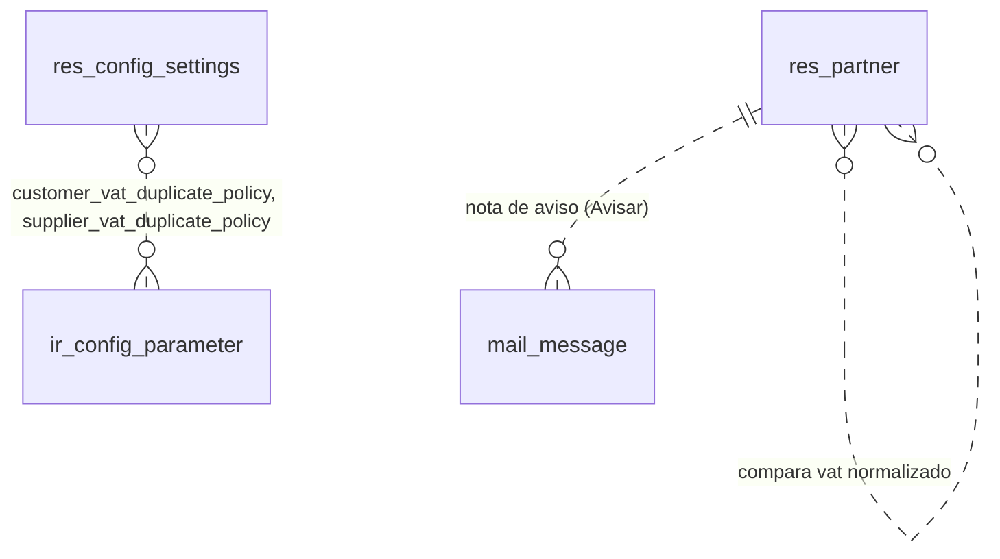

# Control de CUIT repetido

Módulo técnico: `partner_vat_check` · Odoo 20.0 · Dependencias: `account` · Licencia LGPL-3

Bloquea o avisa cuando se guarda desde las apps Clientes o Proveedores un contacto con el CUIT de otro cliente o proveedor.

## Qué hace

- **Control al guardar** un contacto creado o editado desde la app **Clientes** (`customer_management`) o **Proveedores** (`supplier_management`).
- **Un ajuste por app**, con tres opciones:
  - **Bloquear** (por defecto): no deja guardar y dice qué contacto ya tiene ese CUIT.
  - **Avisar:** guarda y deja una nota en el chatter del contacto.
  - **No controlar.**
- Compara el CUIT **sin guiones, puntos ni espacios**: "30-12345678-9" y "30123456789" son el mismo.

Es un módulo técnico (categoría *Hidden*): no tiene menús propios. Se instala solo al instalar alguna de las dos apps.

## Qué agrega o modifica en Odoo

| Dónde | Cambio |
|---|---|
| Contactos (`res.partner`) | Restricción `_check_vat_duplicate_app` (bloqueo) y nota en el chatter al crear o al cambiar el CUIT (aviso). Solo actúan si el contexto trae `partner_vat_check_scope`. |
| Ajustes (`res.config.settings`) | Campos **"CUIT repetido en Clientes"** (`customer_vat_duplicate_policy`) y **"CUIT repetido en Proveedores"** (`supplier_vat_duplicate_policy`). Este módulo no tiene sección de Ajustes propia: cada app muestra el suyo. |
| Parámetros (`ir.config_parameter`) | `partner_vat_check.customer_policy` y `partner_vat_check.supplier_policy`, en `block` al instalar. |

No crea modelos, menús, vistas ni permisos. Fuera de las apps, el comportamiento estándar de Odoo no cambia.

## Cómo funciona

### Cuándo se controla

- Solo si el contacto se guarda con la clave de contexto `partner_vat_check_scope`:
  - `customer`: la ponen la acción del listado de la app Clientes y su botón "Nuevo cliente".
  - `supplier`: la pone la acción del listado de la app Proveedores.

  La ficha abierta desde esos listados hereda el contexto de la acción.
- Al **crear** un contacto y al **cambiar** su CUIT (`vat`) o su contacto padre (`parent_id`). Editar otros campos no dispara el control.
- **No se controla** en Contactos, Facturación, importaciones ni en fichas abiertas desde otros lugares (por ejemplo, un enlace del chatter).

### Con qué contactos se compara

- Contactos **principales** (sin padre), **activos**, de **cualquier empresa**, sin contar el propio.
- **Clientes** compara solo contra clientes (`customer_rank > 0`); **Proveedores**, solo contra proveedores (`supplier_rank > 0`). Un CUIT que solo tiene un proveedor no bloquea un cliente nuevo, y viceversa.
- No se controlan los contactos **hijos** (personas dentro de una empresa), que heredan el CUIT del padre, ni los contactos **sin CUIT**.
- La comparación es en SQL: `regexp_replace(upper(vat), '[^0-9A-Z]', '', 'g')` contra el CUIT normalizado. No depende de las empresas que el usuario tiene habilitadas.

### Qué hace cada opción

| Opción | Al guardar con un CUIT repetido |
|---|---|
| **Bloquear** | Error *"El CUIT 30-12345678-9 ya está cargado en el cliente Ejemplo S.A."* (o "proveedor"). No se guarda. |
| **Avisar** | Se guarda y queda una nota en el chatter: *"Atención: el CUIT 30-12345678-9 también está cargado en el cliente Ejemplo S.A."* |
| **No controlar** | Se guarda sin error ni aviso. |

Si hay varios contactos con ese CUIT, el mensaje los nombra a todos.

Si el parámetro del ajuste no existe (por ejemplo, se borró a mano) o tiene un valor desconocido, se toma **Bloquear**.

## Uso

No tiene pantalla propia. Se usa desde las apps:

1. App **Clientes** → Clientes → **Nuevo cliente** (o abrir un cliente del listado) → cargar el CUIT → **Guardar**.
2. App **Proveedores** → Proveedores → **Nuevo** (o abrir un proveedor del listado) → cargar el CUIT → **Guardar**.

## Configuraciones esenciales

Ajustes (solo administradores):

- App Clientes → Configuración → Ajustes → sección **Clientes**, bloque "Alta de clientes" → **CUIT repetido en Clientes**.
- App Proveedores → Configuración → Ajustes → sección **Proveedores**, bloque "Alta de proveedores" → **CUIT repetido en Proveedores**.

Cada ajuste es independiente. Los dos vienen en **Bloquear** al instalar (datos `noupdate` en [data/ir_config_parameter_data.xml](data/ir_config_parameter_data.xml)): después los decide el administrador y actualizar el módulo no los pisa.

## Permisos

El módulo no tiene `ir.access` ni reglas propias.

| Control | Detalle |
|---|---|
| Lectura del ajuste | `ir.config_parameter` con `sudo()`: los usuarios comunes no pueden leer parámetros. |
| Búsqueda de duplicados | Consulta SQL directa sobre `res_partner`: encuentra duplicados aunque el usuario no vea esos contactos por las reglas de empresa. El mensaje muestra el nombre del contacto duplicado. |
| Nota en el chatter | `message_post` con los permisos del usuario que guarda, que ya pudo crear o editar el contacto. |

## Base de datos

### Resumen

- **Tablas nuevas:** ninguna.
- **Tablas existentes modificadas:** `res_config_settings` (2 columnas, tabla temporal de Ajustes).
- **Datos estándar que escribe:** 2 parámetros en `ir_config_parameter` al instalar; con el ajuste en Avisar, notas en `mail_message` (chatter del contacto).

### Esquema relacional

El módulo no crea tablas. Las líneas punteadas son datos estándar que lee o escribe.



### Tablas nuevas

Ninguna.

### Tablas existentes

| Tabla | Cambio de estructura | Escritura de datos |
|---|---|---|
| `res_config_settings` | Columnas nuevas `customer_vat_duplicate_policy` y `supplier_vat_duplicate_policy` (varchar, nulas): `block` / `warn` / `none`. Tabla temporal de Ajustes. | Solo al abrir y guardar Ajustes |
| `ir_config_parameter` | Ninguno | `partner_vat_check.customer_policy` y `partner_vat_check.supplier_policy` (`block` al instalar; Ajustes los cambia) |
| `res_partner` | Ninguno. No agrega columnas ni índices. | No escribe: solo lee `vat`, `parent_id`, `active`, `customer_rank` y `supplier_rank` |
| `mail_message` | Ninguno | Una nota por guardado con CUIT repetido, solo con el ajuste en Avisar |

### Registros de configuración

Identificados en `ir_model_data` con `module = 'partner_vat_check'`.

| Tabla | Registros |
|---|---|
| `ir_config_parameter` | 2 (`noupdate`) |
| `ir_model` / `ir_model_fields` / `ir_model_fields_selection` | 2 / 6 / 6, generados por Odoo |

### Al desinstalar

- Se borran las 2 columnas de `res_config_settings` y los 2 parámetros.
- Las notas de aviso del chatter **quedan**.
- Si se desinstala, las apps Clientes y Proveedores también se desinstalan, porque dependen de este módulo.

## Instalación y actualización

Se instala solo con `customer_management` o `supplier_management`. A mano:

```powershell
# Instalar
python odoo-bin -r odoo_user -w <password> --addons-path=addons,..\custom_addons -d <base> -i partner_vat_check

# Actualizar
python odoo-bin -r odoo_user -w <password> --addons-path=addons,..\custom_addons -d <base> -u partner_vat_check
```

No necesita librerías de Python extra.

## Limitaciones conocidas

- Solo rige dentro de las apps Clientes y Proveedores. En Contactos, Facturación o importaciones se pueden cargar CUIT repetidos.
- Se controla al guardar: no hay aviso mientras se escribe el CUIT.
- No valida el formato ni el dígito verificador del CUIT.
- Los duplicados que ya existen no se detectan hasta que se cambia el CUIT de alguno desde una app.
- La búsqueda recorre los contactos principales con CUIT en cada guardado, sin índice propio: con muchísimos contactos puede tardar.
- La spec ([SPEC 04](../specs/04-alta-clientes-proveedores.md)) indicaba depender de `mail`; depende de `account` porque `customer_rank` y `supplier_rank` son campos de ese módulo.

## Historial de cambios

### 2026-10-21 — versión 1.0 ([SPEC 04](../specs/04-alta-clientes-proveedores.md))
- **Nuevo:** control de CUIT repetido para las apps Clientes y Proveedores, con un ajuste por app (Bloquear / Avisar / No controlar).
  - Base de datos: no crea tablas. Agrega las columnas `customer_vat_duplicate_policy` y `supplier_vat_duplicate_policy` a `res_config_settings` y 2 parámetros a `ir_config_parameter`. Sin registros en `ir_access`, `ir_ui_view` ni `ir_ui_menu`.
