# Control de inventario

Módulo técnico: `stock_control` · Odoo 20.0 · Dependencias: `stock`, `purchase_stock`, `sale_stock`, `mail` · Licencia LGPL-3

App "Control de inventario" sobre el Inventario de Odoo. Registra entradas y salidas con motivo, arma controles de conteo por depósito y categoría con planilla imprimible, deja cerrados los controles guardados (solo un administrador los reabre) y da una auditoría completa de los movimientos de stock.

Especificación: [SPEC 05](../specs/05-control-de-inventario.md).

## Qué hace

- **Productos y Existencias:** abre las pantallas estándar de Inventario (productos con stock y stock por ubicación), con sus filtros por categoría y depósito.
- **Movimientos manuales:** entradas y salidas cargadas a mano, siempre con un motivo de una lista. Al confirmarlas se mueve el stock y ya no se pueden modificar ni borrar. Se corrigen con **"Revertir"**, que crea y confirma el movimiento inverso.
- **Controles de inventario:**
  1. Se elige un depósito y una o varias categorías.
  2. "Iniciar conteo" arma las líneas: una por producto y ubicación.
  3. Se imprime la planilla de conteo, se cuenta y se carga lo contado.
  4. "Guardar control" ajusta el stock a lo contado y deja el control en solo lectura.
  5. Solo un administrador puede **reabrirlo**, escribiendo un motivo. Al guardarlo de nuevo se generan movimientos de corrección solo por lo que cambió.
- **Auditoría** (solo administradores):
  - **Movimientos:** todos los movimientos de stock hechos, con origen (compra, venta, movimiento manual, control de inventario, desecho u otro), motivo, cantidad con signo y quién los validó. Se filtran, agrupan y exportan.
  - **Ficha por producto (kardex):** saldo inicial, entradas, salidas y saldo acumulado de un producto en un período, en PDF.
  - **Diferencias de controles:** teórico, contado y diferencia de cada línea de los controles guardados. Desde cada control se imprime el "Informe de diferencias" con su historial.
- **Compras:** el listado de productos de Compras muestra la columna **"Stock"**, y la ficha del producto el botón **"Movimientos"**, que abre la auditoría de ese producto.

## Qué agrega o modifica en Odoo

| Dónde | Cambio |
|---|---|
| Menú principal | App nueva **Control de inventario** con Productos, Existencias, Movimientos manuales, Controles de inventario, Auditoría (Movimientos, Ficha por producto, Diferencias de controles) y Configuración (Motivos, Ajustes) |
| Grupos | Privilegio "Control de inventario" con dos grupos: **Usuario** (`group_stock_control_user`, implica *Inventario: Usuario*) y **Administrador** (`group_stock_control_manager`) |
| Modelos nuevos | `stock.control.reason`, `stock.control.manual.move`, `stock.control.manual.move.line`, `stock.control.inventory`, `stock.control.inventory.line`, `stock.control.inventory.event` y los asistentes `stock.control.reopen.wizard` y `stock.control.kardex.wizard` |
| `stock.move` (heredado) | Campos de auditoría: movimiento manual, control y línea de origen, motivo propio, motivo en texto, origen, validado por, cantidad con signo, depósito y categoría. Referencia del movimiento manual. Guarda el usuario que valida en `_action_done` |
| `product.template` (heredado) | Botón "Movimientos" en la ficha (solo Administrador). En el listado de Compras, la columna de existencia se llama "Stock" y se muestra siempre |
| `res.config.settings` (heredado) | Sección "Control de inventario" en Ajustes con "Comparar contra" y "Mostrar cantidad teórica en la planilla" |
| Reportes | Planilla de conteo, Informe de diferencias y Ficha por producto (PDF) |
| Datos | 8 motivos iniciales, 2 secuencias base (`MM/` y `CI/`) y el parámetro `stock_control.theoretical_mode` |

No cambia el comportamiento estándar de Inventario, Compras ni Ventas: el Inventario físico, Desechar y las recepciones y entregas siguen funcionando igual, y aparecen en la auditoría.

## Cómo funciona

### Movimientos manuales

- **Entrada:** desde la ubicación de ajuste de inventario del producto (`property_stock_inventory`) hacia la ubicación elegida. **Salida:** al revés.
- Al confirmar, se crea y se valida un `stock.move` por línea, con el motivo y la referencia = número del movimiento (`MM/AAAA/0001`).
- El motivo tiene que aplicar al tipo (Entrada, Salida o Ambos). La ubicación tiene que ser interna y del depósito elegido.
- Una salida no puede dejar en negativo la ubicación: se compara contra la existencia de esa ubicación exacta, sin ubicaciones hijas. El error dice cuánto hay y cuánto se quiere sacar.
- Confirmado no se edita ni se borra, tampoco por un administrador. "Revertir" crea el movimiento inverso con el mismo motivo, lo confirma y lo enlaza al original. Un movimiento revertido, o que ya es una reversión, no se revierte de nuevo.
- Para revertir una entrada tiene que quedar stock suficiente en la ubicación.

### Controles de inventario

- **Productos:** todos los productos con seguimiento de inventario (`is_storable`) de las categorías elegidas, con subcategorías si está tildado "Incluir subcategorías", aunque tengan stock 0. Quedan afuera servicios y consumibles.
- **Líneas:** una por producto y por ubicación interna del depósito donde tiene existencias (sin lotes). Si no tiene existencias en el depósito, va una línea en la ubicación principal del depósito. Mientras el control está En conteo o Reabierto se pueden agregar líneas a mano.
- **Contada / No contada:** al cargar una cantidad la línea se marca "Contada". Una línea sin marcar es **No contada** y no se ajusta. Para decir que no hay stock, se carga 0 y se tilda "Contada".
- **Comparar contra** (Ajustes), que se copia al control al iniciar el conteo:
  - **Al guardar:** el teórico es la existencia de la ubicación en el momento de guardar. El stock queda exactamente en lo contado.
  - **Al iniciar el conteo:** el teórico se congela al iniciar. Se ajusta (contado − teórico), así que lo que entró o salió durante el conteo se respeta. Una línea agregada a mano toma la existencia de ese momento.
- **Ajuste:** por cada línea contada con diferencia se crea y se valida un `stock.move` de inventario (`is_inventory`) entre la ubicación de la línea y la de ajuste de inventario, con referencia = número del control (`CI/AAAA/0001`).
- **Reapertura:** se ajusta solo la corrección (conteo nuevo − conteo ya aplicado). Los movimientos del primer guardado no se tocan. Una línea ya ajustada no puede volver a No contada, ni cambiar de producto o ubicación.
- **Bloqueo:** un control Guardado o Cancelado no acepta cambios en la cabecera ni en las líneas (el control está en el servidor, no solo en la vista). Depósito y categorías solo se cambian en Borrador. Solo se borran controles en Borrador.
- **Historial:** inicio, guardado, reapertura (con motivo), nuevo guardado y cancelación, con usuario, fecha y cantidad de líneas ajustadas.
- En pantalla, las columnas Teórico, Diferencia y Estado aparecen recién cuando el control está Guardado o Reabierto. Mientras se cuenta solo se ve la casilla "Contada", para no adelantar diferencias (conteo ciego).

### Planilla de conteo

Agrupada por ubicación y categoría, con Código, Producto, Unidad, Cantidad contada y Observaciones en blanco, y lugar para la firma. La columna **Teórico** sale solo si está tildado "Mostrar cantidad teórica en la planilla": en modo "Al iniciar" es el teórico congelado; en modo "Al guardar", la existencia al imprimir.

### Auditoría

- **Origen** de cada `stock.move`, en este orden: Control de inventario, Movimiento manual, Desecho (`is_scrap`), Compra (`purchase_line_id`), Venta (`sale_line_id`) u Otro (transferencias y ajustes del Inventario físico estándar).
- **Motivo:** el motivo propio, las etiquetas del desecho, o el texto cargado al aplicar un ajuste estándar.
- **Cantidad (±):** positiva si entra a una ubicación interna desde una que no lo es, negativa al revés, 0 entre ubicaciones internas.
- **Depósito:** el de la ubicación interna del movimiento (destino en entradas, origen en salidas).
- **Validado por:** el usuario que validó. Queda vacío en los movimientos anteriores a la instalación del módulo.
- **Ficha por producto:** suma la cantidad con signo de los movimientos hechos del producto en la empresa activa (y del depósito, si se elige). El período usa la zona horaria del usuario. Saldo inicial + entradas − salidas = saldo final.

## Uso

1. **Control de inventario → Movimientos manuales → Nuevo:** elegí Entrada o Salida, depósito, ubicación y motivo, cargá los productos y tocá **Confirmar**. Para corregir uno confirmado, abrilo y tocá **Revertir**.
2. **Control de inventario → Controles de inventario → Nuevo:** elegí depósito y categorías y tocá **Iniciar conteo**.
3. Tocá **Imprimir planilla**, contá y cargá lo contado en la pestaña Conteo. Para un producto sin stock, cargá 0 y tildá "Contada".
4. Tocá **Guardar control**. El stock queda ajustado y el control, cerrado.
5. Para corregirlo, un administrador toca **Reabrir**, escribe el motivo, cambia las cantidades y vuelve a tocar **Guardar control**.
6. **Informe de diferencias** (en el control) o **Auditoría → Diferencias de controles** para ver las diferencias.
7. **Auditoría → Movimientos** para revisar todo lo que movió stock. **Auditoría → Ficha por producto** para el kardex en PDF ("Imprimir") o en pantalla ("Ver movimientos").
8. Desde **Compras → Productos**, la columna "Stock" y, en la ficha, el botón **Movimientos**.

## Configuraciones esenciales

### 1. Dar permisos a los usuarios

**Ajustes → Usuarios y compañías → Usuarios**, sección *Control de inventario*: **Usuario** o **Administrador**. Usuario incluye *Inventario: Usuario*, así que esos usuarios también entran a la app Inventario estándar.

### 2. Ajustes del módulo

**Control de inventario → Configuración → Ajustes** (requiere ser administrador de Odoo):

- **Comparar contra:** "Al guardar" (por defecto) o "Al iniciar el conteo". En "Al guardar", conviene cargar el conteo el mismo día que se cuenta.
- **Mostrar cantidad teórica en la planilla:** usa el parámetro estándar `stock.show_expected_quantity_count`. Es el mismo que usan la "Hoja de conteo" y "Solicitar un conteo" de Inventario: cambiarlo en cualquiera de los dos lugares cambia los dos.

### 3. Motivos

**Control de inventario → Configuración → Motivos.** Vienen 8 cargados. Cada uno dice si aplica a Entradas, Salidas o Ambos, y puede limitarse a una empresa.

### 4. Depósitos y ubicaciones

**Inventario → Configuración → Depósitos** y **Ubicaciones**. Cada producto o empresa necesita una ubicación de ajuste de inventario (Odoo la crea por defecto).

### 5. Valuación de inventario

El módulo no usa valores en pesos. Con la valuación **Periódica** (la de Odoo por defecto, **Inventario → Configuración → Ajustes**), los ajustes y movimientos manuales no generan asientos. Si una empresa pasa a **Perpetua**, generan asientos contra las cuentas de la categoría del producto.

### 6. Motor de PDF

La planilla, el informe de diferencias y el kardex usan wkhtmltopdf, igual que el resto de los PDF de Odoo.

## Permisos

Definidos en [security/ir.access.csv](security/ir.access.csv) con el modelo `ir.access` de Odoo 20.

| ID externo | Modelo | Grupo | Operaciones | Filtro (`domain`) | Para qué |
|---|---|---|---|---|---|
| `access_stock_control_reason_user` | `stock.control.reason` | Usuario | Lectura | — | Elegir motivos |
| `access_stock_control_reason_manager` | `stock.control.reason` | Administrador | CRUD | — | Mantener motivos |
| `stock_control_reason_company_rule` | `stock.control.reason` | sin grupo (restricción) | CRUD | `company_id in company_ids + [False]` | Motivos de las empresas permitidas o de todas |
| `access_stock_control_manual_move_user` | `stock.control.manual.move` | Usuario | Crear, leer, modificar | — | Cargar y confirmar movimientos |
| `access_stock_control_manual_move_draft_user` | `stock.control.manual.move` | Usuario | Borrar | `state = draft` | Borrar solo borradores |
| `access_stock_control_manual_move_manager` | `stock.control.manual.move` | Administrador | CRUD | — | Ídem, y borrar cancelados |
| `stock_control_manual_move_company_rule` | `stock.control.manual.move` | sin grupo (restricción) | CRUD | `company_id in company_ids` | Multiempresa |
| `access_stock_control_manual_move_line_user` | `stock.control.manual.move.line` | Usuario | CRUD | — | Productos del movimiento |
| `access_stock_control_inventory_user` | `stock.control.inventory` | Usuario | Crear, leer, modificar | — | Crear, contar y guardar controles |
| `access_stock_control_inventory_draft_user` | `stock.control.inventory` | Usuario | Borrar | `state = draft` | Borrar solo borradores |
| `access_stock_control_inventory_manager` | `stock.control.inventory` | Administrador | CRUD | — | Ídem |
| `stock_control_inventory_company_rule` | `stock.control.inventory` | sin grupo (restricción) | CRUD | `company_id in company_ids` | Multiempresa |
| `access_stock_control_inventory_line_user` | `stock.control.inventory.line` | Usuario | CRUD | — | Cargar el conteo |
| `access_stock_control_inventory_event_user` | `stock.control.inventory.event` | Usuario | Lectura | — | Ver el historial (lo escribe el código) |
| `access_stock_control_reopen_wizard_manager` | `stock.control.reopen.wizard` | Administrador | CRUD | — | Reabrir controles |
| `access_stock_control_kardex_wizard_manager` | `stock.control.kardex.wizard` | Administrador | CRUD | — | Ficha por producto |

"Usuario" es `stock_control.group_stock_control_user` y "Administrador" es `stock_control.group_stock_control_manager` (implica Usuario). Los menús Auditoría y Configuración son solo del Administrador, y Ajustes además pide `base.group_system`.

Controles en el código:

| Acción | Control |
|---|---|
| Modificar o borrar un movimiento manual Confirmado, o sus líneas | `write`, `unlink` y las líneas dan error para cualquier usuario |
| Modificar un control Guardado o Cancelado, o sus líneas | `write` del control y `create`/`write`/`unlink` de las líneas dan error |
| Cambiar depósito o categorías de un control iniciado | Error en `write` |
| Reabrir un control | `_check_manager()` con `has_group('stock_control.group_stock_control_manager')`, en `action_reopen` y en `_reopen`; si no, `AccessError` |
| Cambiar teórico o conteo aplicado de una línea | Error: los calcula el sistema |

Usos de `sudo()`:

- `stock_control_next_name`: lee y copia `ir.sequence` para numerar por empresa. Los usuarios del módulo no tienen permisos sobre secuencias.
- `stock_control_location_qty` y `action_start`: leen `stock.quant` para calcular existencias de ubicaciones del depósito del control (solo lectura).
- `_log_event`: crea el historial del control, que para los usuarios es de solo lectura.
- Lectura de los parámetros `stock_control.theoretical_mode` y `stock.show_expected_quantity_count`.

## Base de datos

### Resumen

- **Tablas nuevas:** 9 (6 permanentes, 1 de relación, 2 temporales).
- **Tablas existentes modificadas:** `stock_move` (10 columnas nuevas). `res_config_settings` suma 2 columnas (tabla temporal de Ajustes).
- **Datos estándar que escribe:**
  - `stock_move` y `stock_move_line`: un movimiento hecho por línea de movimiento manual y por línea ajustada de control. Actualiza `stock_quant` a través de la validación estándar.
  - `ir_sequence` e `ir_sequence_date_range`: la primera vez que una empresa numera, copia la secuencia base para esa empresa.
  - Al instalar, Odoo calcula las columnas nuevas de `stock_move` para los movimientos existentes. `stock_control_done_user_id` queda vacío en ellos.

### Esquema relacional

Tablas del módulo en mayúsculas y estándar en minúsculas. La línea punteada son registros estándar que el módulo crea.

```mermaid
erDiagram
    stock_warehouse ||--o{ STOCK_CONTROL_MANUAL_MOVE : "warehouse_id"
    stock_location ||--o{ STOCK_CONTROL_MANUAL_MOVE : "location_id"
    STOCK_CONTROL_REASON ||--o{ STOCK_CONTROL_MANUAL_MOVE : "reason_id"
    res_company |o--o{ STOCK_CONTROL_MANUAL_MOVE : "company_id"
    STOCK_CONTROL_MANUAL_MOVE |o--o{ STOCK_CONTROL_MANUAL_MOVE : "reversed_move_id"
    STOCK_CONTROL_MANUAL_MOVE ||--o{ STOCK_CONTROL_MANUAL_MOVE_LINE : "manual_move_id"
    product_product ||--o{ STOCK_CONTROL_MANUAL_MOVE_LINE : "product_id"
    res_company |o--o{ STOCK_CONTROL_REASON : "company_id"

    stock_warehouse ||--o{ STOCK_CONTROL_INVENTORY : "warehouse_id"
    res_company |o--o{ STOCK_CONTROL_INVENTORY : "company_id"
    STOCK_CONTROL_INVENTORY ||--o{ PRODUCT_CATEGORY_STOCK_CONTROL_INVENTORY_REL : "category_ids"
    product_category ||--o{ PRODUCT_CATEGORY_STOCK_CONTROL_INVENTORY_REL : "product_category_id"
    STOCK_CONTROL_INVENTORY ||--o{ STOCK_CONTROL_INVENTORY_LINE : "inventory_id"
    product_product ||--o{ STOCK_CONTROL_INVENTORY_LINE : "product_id"
    stock_location ||--o{ STOCK_CONTROL_INVENTORY_LINE : "location_id"
    product_category |o--o{ STOCK_CONTROL_INVENTORY_LINE : "categ_id"
    stock_warehouse |o--o{ STOCK_CONTROL_INVENTORY_LINE : "warehouse_id"
    STOCK_CONTROL_INVENTORY ||--o{ STOCK_CONTROL_INVENTORY_EVENT : "inventory_id"
    res_users ||--o{ STOCK_CONTROL_INVENTORY_EVENT : "user_id"

    STOCK_CONTROL_INVENTORY ||--o{ STOCK_CONTROL_REOPEN_WIZARD : "inventory_id"
    product_product ||--o{ STOCK_CONTROL_KARDEX_WIZARD : "product_id"
    stock_warehouse |o--o{ STOCK_CONTROL_KARDEX_WIZARD : "warehouse_id"

    STOCK_CONTROL_MANUAL_MOVE |o--o{ stock_move : "stock_control_manual_move_id"
    STOCK_CONTROL_INVENTORY |o--o{ stock_move : "stock_control_inventory_id"
    STOCK_CONTROL_INVENTORY_LINE |o--o{ stock_move : "stock_control_inventory_line_id"
    STOCK_CONTROL_REASON |o--o{ stock_move : "stock_control_reason_id"
    res_users |o--o{ stock_move : "stock_control_done_user_id"
    stock_warehouse |o--o{ stock_move : "stock_control_warehouse_id"
    product_category |o--o{ stock_move : "stock_control_categ_id"
    STOCK_CONTROL_MANUAL_MOVE }o..o{ stock_move : "crea al confirmar"
    STOCK_CONTROL_INVENTORY }o..o{ stock_move : "crea al guardar"
```



### Tablas nuevas

#### `stock_control_reason` — permanente

Motivos de los movimientos manuales.

| Columna | Tipo | Nulo | Referencia | ON DELETE |
|---|---|---|---|---|
| `id` | integer | no | — | — |
| `name` | jsonb (traducible) | no | — | — |
| `sequence` | integer | sí | — | — |
| `move_type` | varchar (`in` / `out` / `both`) | no | — | — |
| `active` | boolean | sí | — | — |
| `company_id` | integer | sí | `res_company.id` | SET NULL |

Clave primaria: `id`.

#### `stock_control_manual_move` — permanente

Cabecera de los movimientos manuales.

| Columna | Tipo | Nulo | Referencia | ON DELETE |
|---|---|---|---|---|
| `id` | integer | no | — | — |
| `name` | varchar | sí | — | — |
| `move_type` | varchar (`in` / `out`) | no | — | — |
| `warehouse_id` | integer | no | `stock_warehouse.id` | RESTRICT |
| `location_id` | integer | no | `stock_location.id` | RESTRICT |
| `date` | timestamp | no | — | — |
| `reason_id` | integer | no | `stock_control_reason.id` | RESTRICT |
| `note` | text | sí | — | — |
| `state` | varchar (`draft` / `done` / `cancel`) | no | — | — |
| `company_id` | integer | sí | `res_company.id` | SET NULL |
| `reversed_move_id` | integer | sí | `stock_control_manual_move.id` | SET NULL |

Clave primaria: `id`. Índice parcial en `reversed_move_id`.

#### `stock_control_manual_move_line` — permanente

| Columna | Tipo | Nulo | Referencia | ON DELETE |
|---|---|---|---|---|
| `id` | integer | no | — | — |
| `manual_move_id` | integer | no | `stock_control_manual_move.id` | CASCADE |
| `product_id` | integer | no | `product_product.id` | RESTRICT |
| `quantity` | numeric | no | — | — |

Clave primaria: `id`. Índice en `manual_move_id`.

#### `stock_control_inventory` — permanente

Cabecera de los controles de inventario.

| Columna | Tipo | Nulo | Referencia | ON DELETE |
|---|---|---|---|---|
| `id` | integer | no | — | — |
| `name` | varchar | sí | — | — |
| `warehouse_id` | integer | no | `stock_warehouse.id` | RESTRICT |
| `include_child_categories` | boolean | sí | — | — |
| `date` | date | no | — | — |
| `theoretical_mode` | varchar (`on_save` / `on_start`) | sí | — | — |
| `state` | varchar (`draft` / `in_progress` / `done` / `reopened` / `cancel`) | no | — | — |
| `company_id` | integer | sí | `res_company.id` | SET NULL |

Clave primaria: `id`.

#### `product_category_stock_control_inventory_rel` — permanente (relación)

Categorías de cada control (`stock.control.inventory.category_ids`).

| Columna | Tipo | Nulo | Referencia | ON DELETE |
|---|---|---|---|---|
| `stock_control_inventory_id` | integer | no | `stock_control_inventory.id` | CASCADE |
| `product_category_id` | integer | no | `product_category.id` | CASCADE |

Clave primaria: (`stock_control_inventory_id`, `product_category_id`).

#### `stock_control_inventory_line` — permanente

Una línea por producto y ubicación del control.

| Columna | Tipo | Nulo | Referencia | ON DELETE |
|---|---|---|---|---|
| `id` | integer | no | — | — |
| `inventory_id` | integer | no | `stock_control_inventory.id` | CASCADE |
| `inventory_state` | varchar (relacionado, guardado) | sí | — | — |
| `warehouse_id` | integer (relacionado, guardado) | sí | `stock_warehouse.id` | SET NULL |
| `date` | date (relacionado, guardado) | sí | — | — |
| `company_id` | integer (relacionado, guardado) | sí | `res_company.id` | SET NULL |
| `product_id` | integer | no | `product_product.id` | RESTRICT |
| `default_code` | varchar (relacionado, guardado) | sí | — | — |
| `categ_id` | integer (relacionado, guardado) | sí | `product_category.id` | SET NULL |
| `location_id` | integer | no | `stock_location.id` | RESTRICT |
| `theoretical_qty` | numeric | sí | — | — |
| `counted_qty` | numeric | sí | — | — |
| `is_counted` | boolean | sí | — | — |
| `applied_counted_qty` | numeric | sí | — | — |
| `is_applied` | boolean | sí | — | — |
| `difference_qty` | numeric (calculado, guardado) | sí | — | — |
| `line_state` | varchar (`not_counted` / `ok` / `diff`, calculado) | sí | — | — |

Clave primaria: `id`. Restricciones: `UNIQUE (inventory_id, product_id, location_id)` y `CHECK (counted_qty >= 0)`. Índice en `inventory_id`.

#### `stock_control_inventory_event` — permanente

Historial de cada control.

| Columna | Tipo | Nulo | Referencia | ON DELETE |
|---|---|---|---|---|
| `id` | integer | no | — | — |
| `inventory_id` | integer | no | `stock_control_inventory.id` | CASCADE |
| `event_type` | varchar (`start` / `save` / `reopen` / `resave` / `cancel`) | no | — | — |
| `user_id` | integer | no | `res_users.id` | RESTRICT |
| `date` | timestamp | no | — | — |
| `reason` | text | sí | — | — |
| `adjusted_line_count` | integer | sí | — | — |

Clave primaria: `id`. Índice en `inventory_id`.

#### `stock_control_reopen_wizard` — temporal

| Columna | Tipo | Nulo | Referencia | ON DELETE |
|---|---|---|---|---|
| `id` | integer | no | — | — |
| `inventory_id` | integer | no | `stock_control_inventory.id` | CASCADE |
| `reason` | text | no | — | — |

#### `stock_control_kardex_wizard` — temporal

| Columna | Tipo | Nulo | Referencia | ON DELETE |
|---|---|---|---|---|
| `id` | integer | no | — | — |
| `product_id` | integer | no | `product_product.id` | CASCADE |
| `warehouse_id` | integer | sí | `stock_warehouse.id` | SET NULL |
| `company_id` | integer | no | `res_company.id` | CASCADE |
| `date_from` | date | no | — | — |
| `date_to` | date | no | — | — |

### Tablas existentes

| Tabla | Cambio de estructura | Escritura de datos |
|---|---|---|
| `stock_move` | 10 columnas nuevas: `stock_control_manual_move_id`, `stock_control_inventory_id`, `stock_control_inventory_line_id`, `stock_control_reason_id` (FK, SET NULL), `stock_control_done_user_id` (→ `res_users`, SET NULL), `stock_control_warehouse_id` (→ `stock_warehouse`, SET NULL), `stock_control_categ_id` (→ `product_category`, SET NULL), `stock_control_reason_text` (varchar), `stock_control_origin` (varchar), `stock_control_signed_qty` (numeric). Índices parciales en las tres primeras | Altas al confirmar movimientos manuales y al guardar controles. `stock_control_done_user_id` en cada movimiento que se valida. Recalcula las columnas calculadas de todos los movimientos |
| `stock_move_line`, `stock_quant` | Ninguno | Lo que escribe la validación estándar de los movimientos |
| `res_config_settings` | 2 columnas (tabla temporal): `stock_control_theoretical_mode`, `stock_control_sheet_show_theoretical` | No |
| `ir_config_parameter` | Ninguno | `stock_control.theoretical_mode`. Desde Ajustes, también `stock.show_expected_quantity_count` (estándar) |
| `ir_sequence`, `ir_sequence_date_range` | Ninguno | Copias por empresa de las secuencias base |
| `product_template` | Ninguno | No |

### Registros de configuración

Se identifican en `ir_model_data` con `module = 'stock_control'`.

| Tabla | Registros |
|---|---|
| `ir_access` | 16 (ver [Permisos](#permisos)) |
| `ir_ui_view` | 20: listas, formularios y búsquedas de motivos, movimientos manuales, controles, diferencias y auditoría, 2 herencias de producto, Ajustes, 2 asistentes y 3 plantillas QWeb |
| `ir_act_window` | 7: motivos, movimientos manuales, controles, diferencias, auditoría, ficha por producto y Ajustes |
| `ir_act_report_xml` | 3: planilla de conteo, informe de diferencias y ficha por producto |
| `ir_ui_menu` | 12 |
| `res_groups` / `res_groups_privilege` | 2 / 1 |
| `ir_sequence` | 2 secuencias base (`noupdate`) |
| `ir_config_parameter` | 1 (`noupdate`) |
| `stock_control_reason` | 8 motivos iniciales (`noupdate`) |
| `ir_model_constraint` | 2 |

### Al desinstalar

Antes de borrar los datos del módulo, el `uninstall_hook` (`_uninstall_hook` en `__init__.py`) vacía `stock_control_manual_move`: si no, los motivos iniciales no se pueden borrar porque los movimientos los referencian (clave foránea RESTRICT) y el log muestra errores.

Se borran las tablas nuevas, con todos los movimientos manuales, controles, líneas, historial y motivos, y las 10 columnas de `stock_move`. **Quedan** los `stock_move` hechos y las existencias: el stock no vuelve atrás. Los movimientos pierden el vínculo con su movimiento manual o control, el origen, el motivo y el "validado por" (los ajustes de control conservan la referencia en `inventory_name`).

## Instalación y actualización

El módulo vive en `custom_addons`, que tiene que estar en el addons path. No necesita librerías de Python extra.

```powershell
# Instalar
python odoo-bin -r odoo_user -w <password> --addons-path=addons,..\custom_addons -d <base> -i stock_control

# Actualizar después de cambiar XML, CSV o campos
python odoo-bin -r odoo_user -w <password> --addons-path=addons,..\custom_addons -d <base> -u stock_control
```

Necesita `stock`, `purchase_stock` y `sale_stock` (se instalan como dependencias si faltan; traen `stock_account`).

## Limitaciones conocidas

- Sin lotes ni números de serie: las existencias con lote no entran en los controles.
- Un control es de un depósito completo. No hay controles de una sola ubicación.
- Mientras hay un control abierto no se bloquean recepciones ni entregas. En "Al guardar" hay que cargar el conteo el mismo día.
- En "Al iniciar el conteo", un movimiento entre ubicaciones del mismo depósito durante el conteo deja desactualizado el teórico de esas líneas.
- La app Inventario estándar sigue disponible para los usuarios del módulo: lo que hagan ahí (Inventario físico, transferencias, desechos) no pasa por el control cerrado, pero aparece en la auditoría con su origen.
- La Ficha por producto con un depósito elegido no cuenta las transferencias entre depósitos (entre ubicaciones internas la cantidad con signo es 0). Sin depósito, el saldo final coincide con la existencia.
- El bloqueo de registros guardados no aplica a código con `sudo()` ni a cambios directos en la base.
- La auditoría es "solo Administrador" a nivel de menú. Un Usuario que escribe la dirección de la acción la puede abrir, porque los movimientos (`stock.move`) los lee cualquier usuario de Inventario (también en Inventario → Informes). Las líneas de controles también las lee el Usuario, porque las necesita para contar. En Odoo 20, los grupos de una acción no impiden abrirla por su dirección.
- La numeración usa secuencias estándar: si una confirmación falla después de tomar el número, ese número se pierde y queda un salto (por ejemplo, de `MM/2026/0002` a `MM/2026/0004`).
- "Validado por" queda vacío en los movimientos anteriores a la instalación.
- Sin valorización en pesos (SPEC 06).

## Historial de cambios

### 2026-10-22 — versión 1.0 (verificación en el navegador)
- **Corrección:** mientras el control está En conteo, la columna Estado mostraba "Con diferencia" o "Sin diferencia" contra un teórico que todavía no es definitivo (Al guardar) o que debe quedar oculto (conteo ciego). Ahora la columna Estado y el rojo de las diferencias aparecen recién con el control Guardado o Reabierto.
  - Base de datos: se actualiza `arch_db` de la vista `stock_control_inventory_view_form` en `ir_ui_view`. Sin cambios de tablas ni de datos.
- **Corrección:** al desinstalar, el log mostraba errores al borrar los motivos usados por movimientos manuales. Se agrega `uninstall_hook`, que vacía los movimientos manuales antes de que Odoo borre los datos del módulo.
  - Base de datos: sin cambios de estructura. Solo actúa al desinstalar: borra las filas de `stock_control_manual_move` (y en cascada `stock_control_manual_move_line`), que se perderían igual con sus tablas.

### 2026-10-22 — versión 1.0 ([SPEC 05](../specs/05-control-de-inventario.md))
- **Nuevo:** app Control de inventario con grupos Usuario y Administrador, motivos, movimientos manuales con Revertir, controles de inventario con planilla, guardado con ajuste y bloqueo, reapertura con motivo y corrección, auditoría de movimientos, ficha por producto, diferencias de controles, y columna "Stock" y botón "Movimientos" en los productos de Compras.
  - Base de datos: tablas nuevas `stock_control_reason`, `stock_control_manual_move`, `stock_control_manual_move_line`, `stock_control_inventory`, `product_category_stock_control_inventory_rel`, `stock_control_inventory_line`, `stock_control_inventory_event` y las temporales `stock_control_reopen_wizard` y `stock_control_kardex_wizard`; 10 columnas nuevas en `stock_move` (calculadas para los movimientos existentes); 16 registros en `ir_access`, 20 vistas, 7 acciones, 3 reportes, 12 menús, 2 grupos y 1 privilegio, 2 secuencias, 1 parámetro y 8 motivos.
