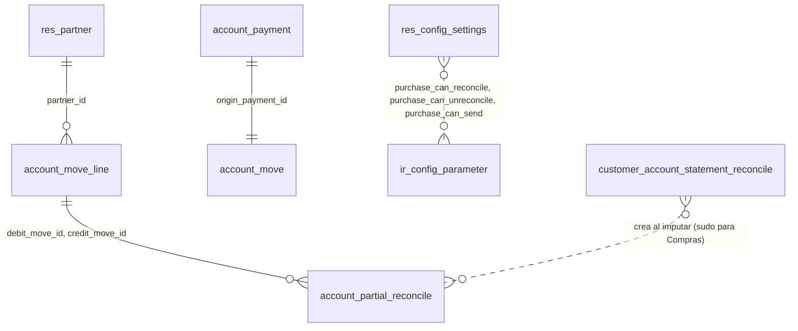

# Proveedores

Módulo técnico: `supplier_management` · Odoo 20.0 · Dependencias: `customer_account_statement`, `purchase` · Licencia LGPL-3

App "Proveedores" que reúne en un solo lugar el listado de proveedores, su estado de cuenta, las facturas y notas, los pagos realizados, los comprobantes vencidos y las órdenes de compra.

## Qué hace

- **App propia** en el menú principal, con ícono, para Facturación y Compras.
- **Listado de Proveedores** con filtros (Proveedores, Con deuda, Con vencidos), búsqueda y agrupación por empresa, ciudad y provincia.
- **Estado de cuenta de proveedores:** el de `customer_account_statement` en modo Proveedor (cuentas a pagar), con imputación, PDF y email.
- **Accesos directos** a facturas y notas de proveedor, pagos realizados, comprobantes vencidos y órdenes de compra.
- **Permisos de Compras configurables:** los usuarios de Compras siempre consultan e imprimen; imputar, desimputar y enviar por email se habilitan con tres casillas en Ajustes.

## Qué agrega o modifica en Odoo

| Dónde | Cambio |
|---|---|
| Menú principal | App **Proveedores** (`menu_supplier_management_root`) con los menús de la [tabla de Uso](#uso). |
| Contactos (`res.partner`) | Campos calculados **Con deuda a pagar** (`has_payable_debt`) y **Con vencidos a pagar** (`has_overdue_payable`), sin columna en la base. Vista lista y búsqueda propias de la app, que no reemplazan las de Contactos. |
| Ficha del contacto | El botón **"Cuenta proveedor"** (de `customer_account_statement`) también se muestra a los usuarios de Compras. |
| Estado de cuenta (`customer.account.statement`) | Hereda los controles de permisos para dar acceso a Compras en el modo Proveedor (ver [Permisos](#permisos)). |
| Imputación (`customer.account.statement.reconcile`) y desimputación (`account.partial.reconcile`) | Para Compras, se ejecutan con `sudo()` después de verificar el permiso. |
| Ajustes | Sección **Proveedores** con tres casillas (`ir.config_parameter` `supplier_management.purchase_can_reconcile`, `..._unreconcile` y `..._send`). |
| Permisos | Accesos de Compras a los modelos del estado de cuenta, y lectura de pagos a proveedores y sus asientos. |

No crea modelos nuevos. No modifica facturas, pagos ni órdenes de compra: los menús abren las pantallas estándar con un filtro.

## Cómo funciona

### Qué es un proveedor en el listado

- Contactos principales: empresas o contactos sin padre (`is_company = True` o `parent_id = False`).
- El filtro **"Proveedores"** (`supplier_rank > 0`: alguna vez se le cargó una factura de proveedor) viene activo y se puede quitar.
- No hay columna de saldo: con varias monedas no hay un único importe correcto. El saldo se ve en el estado de cuenta.

### Con deuda / Con vencidos

Usan la misma regla que el estado de cuenta de proveedores, para que coincidan:

- Apuntes en cuentas **a pagar** (`liability_payable`), de asientos **publicados**, del proveedor y sus contactos hijos.
- Empresas: las "Empresas en las que participa" del proveedor que el usuario tiene habilitadas. Si el proveedor no tiene ninguna, todas las empresas del usuario.
- **Con deuda:** en alguna moneda de empresa, la suma de pendientes es **menor que cero** (signo contable: se le debe al proveedor).
- **Con vencidos:** tiene al menos una factura o ND con pendiente negativo y vencimiento anterior a hoy. Los pagos y NC con saldo a favor no cuentan como vencidos.

### Estado de cuenta de proveedores

El menú **Estado de cuenta** abre el asistente de `customer_account_statement` en modo Proveedor (`action_supplier_account_statement`). Signo, modos, consolidado, imputación, PDF y email se explican en el [README de customer_account_statement](../customer_account_statement/README.md).

### Permisos de Compras

"Usuario de Compras" es quien tiene `purchase.group_purchase_user` y **no** tiene Facturación (`account.group_account_invoice`).

- **Consultar e imprimir:** siempre, para **todos** los proveedores. No hay comprador asignado.
- **Imputar, desimputar, enviar por email:** cada uno según su casilla en Ajustes. Las tres vienen tildadas al instalar.
- **Clientes:** el usuario de Compras no puede abrir el estado de cuenta de un cliente. Recibe un error de acceso.
- Con una casilla destildada, el botón no aparece y llamar a la acción directamente da error de acceso.

Las casillas son **globales**: valen para todas las empresas.

## Uso

Entrar a la app **Proveedores** desde el menú principal.

| Menú | Qué muestra | Quién lo ve |
|---|---|---|
| **Proveedores** | Listado de proveedores con filtros | Facturación y Compras |
| **Estado de cuenta** | Asistente del estado de cuenta en modo Proveedor | Facturación y Compras |
| **Facturas y notas** | Facturas, notas de crédito y notas de débito de proveedor | Facturación y Compras |
| **Pagos realizados** | Pagos a proveedores | Facturación y Compras |
| **Comprobantes vencidos** | Facturas y notas de débito de proveedor publicadas, impagas o pagadas en parte, con vencimiento anterior a hoy | Facturación y Compras |
| **Órdenes de compra** | Órdenes de compra estándar de Compras | Facturación y Compras |
| **Configuración → Ajustes** | Sección Proveedores de Ajustes | Solo administradores |

**Lugar reservado:** entre "Órdenes de compra" y "Configuración" va a ir el menú **"Carga automática de facturas"** (`menu_supplier_management_bill_import`, secuencia 70). Hoy no existe: lo crea la spec de carga automatizada de facturas de proveedor.

También se entra al estado de cuenta desde la ficha del proveedor, con el botón **"Cuenta proveedor"**, y desde Contabilidad / Facturación → Proveedores → Estado de cuenta (solo Facturación).

## Configuraciones esenciales

### 1. Usuarios

Ajustes → Usuarios y compañías → Usuarios → elegir el usuario.

| Perfil | Grupo en Odoo | Qué puede hacer |
|---|---|---|
| Facturación / Contabilidad | *Facturación* o superior (`account.group_account_invoice`) | Todo, sin depender de las casillas. |
| Compras | *Compras: Usuario* o superior (`purchase.group_purchase_user`) | Consultar e imprimir siempre. Imputar, desimputar y enviar según las casillas. |

Un vendedor sin Facturación ni Compras no ve la app.

### 2. Permisos de Compras

Entrar a Proveedores → Configuración → **Ajustes** (o Ajustes → **Proveedores**), bloque "Permisos de Compras en el estado de cuenta de proveedores":

- **Compras puede imputar**.
- **Compras puede desimputar**.
- **Compras puede enviar el estado de cuenta por email**.

Al instalar, las tres vienen tildadas (datos `noupdate` en `data/ir_config_parameter_data.xml`).

- Al destildar una y guardar, Odoo 20 guarda el parámetro con valor `False`; no lo borra.
- Si se borra el parámetro a mano, la casilla queda destildada, y actualizar el módulo no lo vuelve a crear.

### 3. Empresas y datos del proveedor

Igual que en el estado de cuenta: "Empresas en las que participa" en la ficha del proveedor, empresas habilitadas del usuario, email del proveedor para el envío y servidor de correo saliente. El detalle está en el [README de customer_account_statement](../customer_account_statement/README.md#configuraciones-esenciales).

## Permisos

Definidos en [security/ir.access.csv](security/ir.access.csv) con el modelo `ir.access` de Odoo 20. Todos llevan grupo, así que **suman** a los permisos que el usuario ya tenga (se combinan con OR).

| ID externo | Modelo | Grupo | Operaciones | Filtro (`domain`) | Para qué |
|---|---|---|---|---|---|
| `access_supplier_management_statement_purchase` | `customer.account.statement` | Compras | CRUD | — | Usar el asistente del estado de cuenta |
| `access_supplier_management_statement_line_purchase` | `customer.account.statement.line` | Compras | CRUD | — | Ver y generar las líneas |
| `access_supplier_management_statement_currency_purchase` | `customer.account.statement.currency` | Compras | CRUD | — | Ver y generar "Saldos por moneda" |
| `access_supplier_management_statement_reconcile_purchase` | `customer.account.statement.reconcile` | Compras | CRUD | — | Asistente de imputación |
| `access_supplier_management_statement_reconcile_line_purchase` | `customer.account.statement.reconcile.line` | Compras | CRUD | — | Comprobantes del asistente de imputación |
| `supplier_management_payment_purchase` | `account.payment` | Compras | Lectura | `partner_type = 'supplier'` | Abrir pagos a proveedores |
| `supplier_management_move_purchase` | `account.move` | Compras | Lectura | `origin_payment_id.partner_type = 'supplier'` | Abrir los asientos de esos pagos |

"Compras" es `purchase.group_purchase_user`. Facturas de proveedor, apuntes e imputaciones ya los da el módulo estándar `purchase` a ese grupo.

Las dos últimas amplían permisos sobre modelos **estándar**: los usuarios de Compras pueden ver los pagos a proveedores en cualquier pantalla de Odoo, solo en lectura. No ven pagos de clientes.

Controles en el código ([wizard/account_statement_wizard.py](wizard/account_statement_wizard.py)), que extienden los de `customer_account_statement`:

| Método | En modo Proveedor, además de Facturación |
|---|---|
| `_check_partner_access` | Deja pasar a `purchase.group_purchase_user` |
| `_can_reconcile` | Compras, si `supplier_management.purchase_can_reconcile` es verdadero |
| `_can_unreconcile` | Compras, si `supplier_management.purchase_can_unreconcile` es verdadero |
| `_can_send` | Compras, si `supplier_management.purchase_can_send` es verdadero |

Usos de `sudo()`:

| Dónde | Por qué | Qué se verifica antes |
|---|---|---|
| `customer.account.statement.reconcile.action_reconcile` | Compras no tiene permiso estándar sobre los asientos de pago | Acceso al proveedor y casilla "Compras puede imputar". Después, `customer_account_statement` valida proveedor, empresa, cuenta a pagar, estado, signo e importes. |
| `account.partial.reconcile.action_statement_unreconcile` | Compras no puede borrar imputaciones | Casilla "Compras puede desimputar" para **cada** imputación. Una imputación de cuentas a cobrar da error. |
| Lectura de `ir.config_parameter` | Los usuarios comunes no leen parámetros | — |

## Base de datos

### Resumen

- **Tablas nuevas:** ninguna.
- **Tablas existentes modificadas:** `res_config_settings` (3 columnas booleanas, temporal).
- **Datos estándar que escribe:** 3 registros en `ir_config_parameter` al instalar. Cuando Compras imputa o desimputa, se crean y borran filas de `account_partial_reconcile`, como en `customer_account_statement`.

### Esquema relacional

El módulo no crea tablas. Las líneas punteadas son registros estándar que escribe o lee.



### Tablas nuevas

Ninguna.

### Tablas existentes

| Tabla | Cambio de estructura | Escritura de datos |
|---|---|---|
| `res_config_settings` | Columnas nuevas `purchase_can_reconcile`, `purchase_can_unreconcile`, `purchase_can_send` (boolean, nulas). Tabla temporal de Ajustes. | No |
| `res_partner` | Ninguno. `has_payable_debt` y `has_overdue_payable` son calculados, sin columna (se buscan con una consulta SQL agregada). | No |
| `ir_config_parameter` | Ninguno | Sí: 3 parámetros `supplier_management.purchase_can_*` con valor `True` al instalar; Ajustes los cambia |
| `account_partial_reconcile` | Ninguno | Sí: altas al imputar y bajas al desimputar desde Compras |
| `customer_account_statement`, `customer_account_statement_reconcile` | Ninguno (las tablas son de `customer_account_statement`) | Solo las consultas temporales de cada usuario |

### Registros de configuración

Se identifican en `ir_model_data` con `module = 'supplier_management'`.

| Tabla | Registros |
|---|---|
| `ir_access` | 7 (ver [Permisos](#permisos)) |
| `ir_ui_view` | 4: lista y búsqueda de Proveedores, herencia del botón "Cuenta proveedor" y sección de Ajustes |
| `ir_act_window` | 5: Proveedores, Facturas y notas, Pagos realizados, Comprobantes vencidos y Ajustes |
| `ir_ui_menu` | 9: raíz de la app, 6 menús, Configuración y Ajustes |
| `ir_config_parameter` | 3 (`noupdate`) |
| `ir_model` / `ir_model_fields` | 5 / 17, generados por Odoo para los modelos heredados y sus campos |

### Al desinstalar

- Se borran los menús, las vistas, las acciones, los permisos y los 3 parámetros de Ajustes.
- Las imputaciones hechas por Compras **quedan**: son datos contables estándar.
- El estado de cuenta de proveedores sigue disponible para Facturación, porque es de `customer_account_statement`.

## Instalación y actualización

El módulo vive en `custom_addons`, que tiene que estar en el addons path. Instala `purchase` si no está instalado.

```powershell
# Instalar
python odoo-bin -r odoo_user -w <password> --addons-path=addons,..\custom_addons -d <base> -i supplier_management

# Actualizar después de cambiar XML, CSV o campos
python odoo-bin -r odoo_user -w <password> --addons-path=addons,..\custom_addons -d <base> -u supplier_management
```

Necesita `customer_account_statement` versión 1.2 o posterior, que trae el modo Proveedor.

No necesita librerías de Python extra.

## Limitaciones conocidas

- No hay comprador asignado: Compras ve el estado de cuenta de **todos** los proveedores.
- Las casillas de permisos son globales, no por empresa.
- La lectura que se agrega para Compras cubre pagos a proveedores y sus asientos. Un asiento manual en la cuenta a pagar de un proveedor aparece en el estado de cuenta, pero Compras recibe error de acceso si lo abre con "Abrir comprobante".
- Los filtros Con deuda y Con vencidos repiten la lógica de `customer_management` para cuentas a pagar, para no depender de la app Clientes.
- La carga automática de facturas de proveedor todavía no existe: solo está reservado su lugar en el menú.

## Historial de cambios

### 2026-10-21 — versión 1.0 ([SPEC 03](../specs/03-app-proveedores.md))
- **Nuevo:** app Proveedores con listado y filtros, estado de cuenta de proveedores, facturas y notas, pagos realizados, comprobantes vencidos, órdenes de compra y Ajustes con los permisos de Compras.
  - Base de datos: no crea tablas. Agrega 3 columnas booleanas a `res_config_settings`, 3 parámetros a `ir_config_parameter`, 7 registros a `ir_access`, 4 vistas a `ir_ui_view`, 5 acciones a `ir_act_window` y 9 menús a `ir_ui_menu`.
